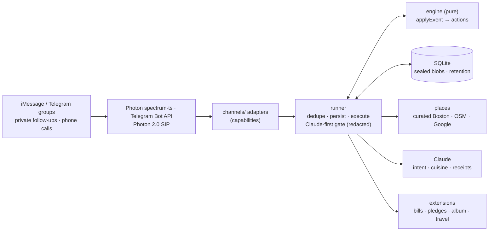

# Whats the Word

**Homi is the friend in your group chat who gets everyone to dinner and splits the bill.** Add it to the chat your friends already use (iMessage through [Photon](https://photon.codes), or Telegram). Nobody installs an app, nobody shares a calendar, and nobody has to be the one who chases. Built at HackHarvard 2026 for Photon's *Build a Messaging Agent with Photon 2.0* challenge.

Watch it: [vertical](story/out/homi-phone-1080x1920.mp4) · [landscape](story/out/homi-demo-1920x1080.mp4) (1:17).

## The problem

Plans die in the group chat, and the numbers behind it are not small.

| | Finding | Source |
|---|---|---|
| **Friends see each other less than half as much.** | Americans aged 15–24 spent **153 minutes a day** with friends in person in 2003 and **67** in 2019. | [Kannan & Veazie 2023](https://pmc.ncbi.nlm.nih.gov/articles/PMC9811250/), American Time Use Survey |
| **A question to the group is a question to nobody.** | Ask one person for help and **36%** reply. Ask the same thing with 14 or 49 others copied and **14%** reply. That is every "we should hang out!!" with four hearts and no answer. | Blair, Thompson & Wuensch, *Basic & Applied Social Psychology* 2005 |
| **Someone ends up doing all the asking.** | In the average relationship one person is **almost twice as likely** to start contact, and the longer one side keeps initiating alone, the more likely the relationship is to end. | Mollgaard & Mathiesen, *PLoS ONE* 2016 |
| **Silence hurts the one who asked.** | When a message was read but got no reply, **42.8%** of senders felt upset or angry and **26.9%** felt slighted or ignored. | Hoyle et al., ACM CHI 2017 (N=402) |

Put those together and you get the organizer: the one friend who proposes the date, follows up with the quiet ones, picks the place, fronts the bill and then chases the money. Every unanswered message lands on them. The group feels fine, because nobody in a group feels responsible; the organizer feels like they are nagging, and when they stop, the group stops meeting.

Homi takes that job. It proposes, it follows up privately so nobody is called out in front of everyone, it decides by majority so nobody gets steamrolled, and it does the math. The humans just answer.

## What Homi does

One plan, start to finish. This is a real run of the engine (`npm run sim`, Boston, no LLM):

```
You   homi dinner friday 7pm
Homi  Dinner, Friday. Tap ❤️ on every time that works (or reply like "fri or sat"); I'll lock it in once everyone answers.
Homi  1 · Fri Oct 23 · 7pm
Ana   ❤️ on 1
Homi  Fri Oct 23 · 7pm it is: 2 in.
Homi  What are we feeling? Tacos, sushi, pizza, Thai, anything; or say "surprise us".
Ana   thai                          👍
Ben   sushi for me                  👍
You   ok thai then                  👍
Homi  Thai in Boston, here are 3. Tap ❤️ on your pick (or reply 1, 2 or 3).
Homi  1 · 9 Tastes · Harvard Square · $
Homi  2 · Dakzen · Davis Square · $$
Homi  3 · Brown Sugar Café · Fenway · $$
Ana   ❤️ on 2
Ben   2                             👍
Homi  Dakzen it is: 195 Elm Street, Somerville https://maps.apple.com/?q=Dakzen 🍜
Homi  Locked: Fri Oct 23, 7pm · Dakzen · 2 in. I'll remind you the day before.
You   homi split 84 3 ways
Homi  $84.00 split 3 ways: $28.00 each.
You   homi what do you know
Homi  Here's everything I have for this chat: settings (tone normal, time zone America/New_York, notice off) ·
      plan "dinner" (Friday), confirmed · chosen Fri Oct 23 7pm (2 yes) · place Dakzen, 195 Elm Street, Somerville ·
      3 people: 2 answered, 1 pending · names I know: You, Ana, Ben · food answers: Thai 2 · deletes Sat 7pm.
You   homi forget
Homi  Done: I've deleted this plan.
```

What happened in there:

- **A date with nobody's calendar.** Say a day and a time and the person who named it is in; everyone else taps ❤️ or answers in words ("fri works", "can't do thu", "I want to do earlier"). A window like "next week" gets three proposals instead of one. The lock happens when everyone has answered, or at the announced deadline.
- **The quiet friend gets asked privately.** After 30 seconds without an answer, Homi tells the group who is still missing and messages them one to one: *"does Fri Oct 23 · 7pm work for you for dinner? Reply yes, no, or a number."* Their reply lands back in the plan as their vote. Nobody is called out, nobody has to chase. If only one person can make it, Homi says so and cancels instead of booking a dinner for one.
- **The cuisine is decided by majority.** Each person's latest answer counts, so "ok thai then" moves a vote. Claude maps whatever people say ("pad thai sounds great", "something with noodles") onto one of 15 cuisines; a split gets the tally ("No majority yet: Thai 1 · Japanese 1 · Pizza 1. Need 2 of 3 on one"), "surprise us" ends it, and the group votes on three real Boston spots with an address and a maps link at the end.
- **The bill.** Send the receipt photo and say "homi split the bill" (or "3 ways", "between ana ben me", "paid by ana"): Claude reads the total off the photo and Homi does the math, to the cent. Equal, custom and itemized splits with tax, tip and several payers, and "homi settle up" for who pays whom, are all in [docs/BILLS.md](docs/BILLS.md).
- **Homi always answers when you talk to it.** Say "homi" and you get an answer: the open question again, or "Not sure what you mean" with a hint. Everything else in the chat it leaves alone.

Also in the engine, documented in [docs/FEATURES.md](docs/FEATURES.md): show-up pledges where the group agrees first where no-show money goes ([COMMITMENTS](docs/COMMITMENTS.md); Homi never moves real money in this build), a members-only photo album ([ALBUM](docs/ALBUM.md)), trip planning with labeled cost estimates ([TRAVEL](docs/TRAVEL.md)), reminders, `.ics` invites and a phone call to the quiet friend who opted in ([VOICE_SETUP](docs/VOICE_SETUP.md)).

## Memory and privacy

Homi remembers what the group would want a friend to remember, and nothing else.

- **It keeps names.** "homi I'm Ana" is remembered for this chat, so the next plan greets Ana by name without asking again. On a dedicated iMessage line it also knows who is in the group before anyone speaks, so "everyone answered" means everyone.
- **It keeps the plan, the running bill and the group's settings** (tone, quiet hours, notice mode), encrypted at rest.
- **It never keeps your messages.** A message not addressed to Homi gets one local check (is this my name, a vote, or an answer to my question?) and is dropped. Nothing readable is stored: plan data is sealed with AES-256-GCM and people are hashed ids.
- **It forgets on schedule and on command.** A plan deletes itself 24 hours after the event. "homi forget" deletes it now. "homi stop" deletes everything for the chat, names included, and Homi leaves.
- **Claude sees redacted snippets only.** With Claude-first on, it reads messages addressed to Homi and, while a plan is open, plan talk (a day, a time, a cuisine). Names, handles, numbers and links are replaced with placeholders before anything leaves the machine; other chatter is never sent.
- **Location:** never asked for. **Money:** never moved.

Ask *"homi what do you know"* at any time to see all of it. Full model: [docs/PRIVACY.md](docs/PRIVACY.md).

## Run it

Requirements: **Node 22.5+** (it uses the built-in `node:sqlite`) and git.

```bash
git clone https://github.com/ehabda05/wtw.git && cd wtw && npm install && npm test
```

Try the engine offline, in a fake group chat with six personas (`ana: homi dinner friday 7pm`, `/react ana ❤️ 1`, `/ff 30s`, `/help`):

```bash
npm run sim
```

**Live, in a Telegram group** (the quickest real surface): create a bot with @BotFather, turn its privacy mode off (`/setprivacy` → Disable), then

```bash
cp .env.example .env && npm run keys
```

Paste the printed `DATA_KEY` and `ID_SALT` into `.env`, add `TELEGRAM_BOT_TOKEN` and `ANTHROPIC_API_KEY`, set `SURFACES=telegram-direct`, and start Homi:

```bash
DEMO_SIMPLE=on QUORUM_DM_AFTER_MS=30000 QUORUM_REPLY_MS=15000 MIN_ATTENDEES=2 npm start
```

Add the bot to your group by its full @username and type `homi dinner friday 7pm`. Telegram can only message people privately who have opened the bot once, so have everyone tap it first. On Windows PowerShell use `npm.cmd` and `$env:SURFACES="telegram-direct"; npm.cmd start`.

**Live, in an iMessage group:** a dedicated iMessage line from Photon (`SURFACES=imessage`, `SPECTRUM_IMESSAGE_LINE=dedicated`); Homi then also knows the group's roster. Shared lines on free Photon projects work in 1:1 chats only. Every surface, every variable and the Photon 2.0 managed bot are in [docs/CHANNELS.md](docs/CHANNELS.md).

| Setting | What it does |
|---|---|
| `DEMO_SIMPLE=on` | The one flow above: date → private follow-up → cuisine by majority → three spots → bill. Pledges, albums, trips and the budget questions are off. |
| `QUORUM_DM_AFTER_MS`, `QUORUM_REPLY_MS`, `MIN_ATTENDEES` | How long Homi waits before asking the quiet ones privately, how long it gives them, and how many yes votes make a plan. Demo values `30000`, `15000`, `2`; without them the real ladder is hours, not seconds. |
| `HOMI_LLM_FIRST=on` | Claude reads every message addressed to Homi (and plan talk while a plan is open) before the rules do; exact commands and votes stay local. `HOMI_LLM_MODEL` defaults to `claude-haiku-5-5`. |
| `PLACES_PROVIDER=google` + `PLACES_API_KEY` | Live restaurant search outside the curated Boston list and the offline OpenStreetMap snapshot. |

## What we measured

Ten role-play group chats ([eval/fixtures](eval/fixtures/README.md)) were written blind from the spec by a separate agent that could read `docs/` but never `src/`, so the labels say what the spec promises, not what the code does. `npm run eval` replays them through the real stack (the offline group chat, runner, engine, encrypted store, scheduler on a fake clock, offline places) and scans every log line and database value for leaks.

| What | Right | Wrong | Error rate |
|---|---|---|---|
| Per-day votes read from date replies | 133 of 135 day-cells | 2 | **1.5%** |
| Whole date reply read exactly right | 43 of 45 messages | 2 | 4.4% |
| Final date chosen | 10 of 10 fixtures | 0 | 0% |
| Reason for the lock (everyone / deadline / threshold / forced) | 10 of 10 | 0 | 0% |
| Message intent, 7 classes | 175 of 183 messages | 8 | 4.4% |
| Food talk that starts the place flow | 0 false starts in 183 messages | 12.1% of food talk missed | precision 100%, recall 87.9% (unaddressed food talk starts the flow only when the rules and the classifier agree; a false start is worse than a miss) |
| Place flow started exactly when it should | 10 of 10 | 0 | 0% |
| Recommendation matches the stated cuisine and budget | 3 of 4 | 1 | the map snapshot has no Thai spot near Harvard Square; Homi says so and offers the nearest alternatives |
| Unprompted messages to the group | 5 across all fixtures; the noise budget held in 10 of 10, quiet hours never broken | 0 | 0% |
| Log lines containing message text, a phone number, an email or a handle | 0 of 502 | 0 | 0% |
| Database values containing plaintext message text or numbers | 0 | 0 | 0% |

Ten conversations with 183 labeled messages is a sanity check, not a benchmark. Unit tests: **533 passing** (`npm test`) across the engine, bills, store, privacy, runner, channels, places, voice and the Claude gate.

## How it works



The engine is a pure function: `applyEvent(state, event, ctx)` returns the new state and a list of actions (send, react, DM, schedule, purge). That is why the same code runs unchanged in the offline chat, under the eval, and on every live surface, and why every rule has a test. Details: [ARCHITECTURE](docs/ARCHITECTURE.md) · [STATE_MACHINE](docs/STATE_MACHINE.md) · [DATE_FINDING](docs/DATE_FINDING.md) · [HUNGRY_FLOW](docs/HUNGRY_FLOW.md).

## Docs

| Doc | What's in it |
|---|---|
| [DEMO_STORY.md](docs/DEMO_STORY.md) | The video: beat sheet, script, the psychology behind each beat |
| [DATE_FINDING.md](docs/DATE_FINDING.md) · [HUNGRY_FLOW.md](docs/HUNGRY_FLOW.md) · [BILLS.md](docs/BILLS.md) | Finding a date, picking a place, splitting the bill |
| [PRIVACY.md](docs/PRIVACY.md) | What Homi reads, keeps, sends to Claude, and deletes |
| [CHANNELS.md](docs/CHANNELS.md) · [VOICE_SETUP.md](docs/VOICE_SETUP.md) | Telegram, iMessage and Photon 2.0 setup; the phone call |
| [ARCHITECTURE.md](docs/ARCHITECTURE.md) · [STATE_MACHINE.md](docs/STATE_MACHINE.md) · [FEATURES.md](docs/FEATURES.md) | How it's built, the plan states, the full feature list |
| [COMMITMENTS.md](docs/COMMITMENTS.md) · [ALBUM.md](docs/ALBUM.md) · [TRAVEL.md](docs/TRAVEL.md) | Pledges, the album, trips |

## Credits

- **Map data:** © OpenStreetMap contributors, [ODbL 1.0](https://www.openstreetmap.org/copyright).
- **Weather:** US National Weather Service API.
- **Messaging and voice:** Photon. **Voice agent:** Retell. **Language model:** Claude.

## License

MIT
