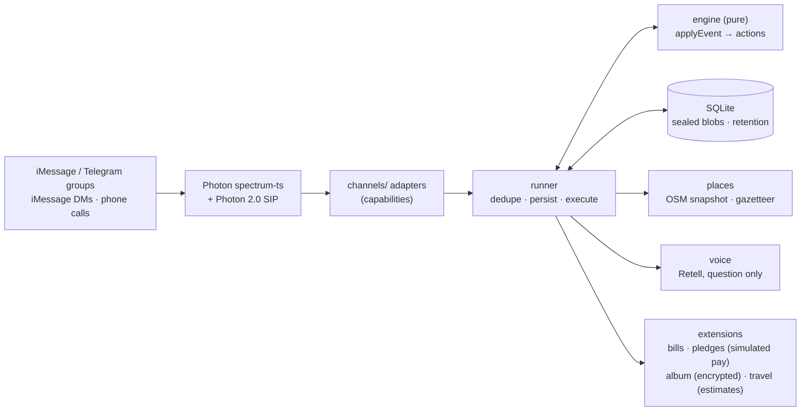

# Whats the Word

**Homi is the friend in your group chat who makes plans happen.** It finds the date, picks the place and checks in on quiet friends. It splits the bill fairly, keeps the photos and plans the next trip, and it forgets what it no longer needs.

Homi lives inside the chats your friends already use: iMessage, Telegram and real phone calls, through [Photon](https://photon.codes). Nobody installs an app. Built at HackHarvard 2026 for Photon's *Build a Messaging Agent with Photon 2.0* challenge.

> **Status, in one line:**
> - **Works end to end:** the planning engine, bill splitting, travel planning (estimates), pledges (simulated payments) and the shared album, all in the offline simulator and the demo video.
> - **Wired but not yet verified live:** the Photon chat adapters and voice.
> - **Needs real integrations:** real money movement, live travel search and production photo storage.
>
> Details are in [Implemented, simulated, unfinished](#implemented-simulated-unfinished).

---

## The problem

Plans die in the group chat, and friendships die with them.

- **Nobody follows up.** Someone says "we should hang out!!", four people heart it, two never answer. Nobody wants to nag, so the thread goes quiet.
- **The organizer burns out.** The person who chases everyone becomes "the organizer". That's unpaid emotional labor, and when they burn out, the group stops meeting.
- **Even good nights leave friction.** After the dinner someone fronts the bill, nobody remembers who owes what, the photos are scattered, and "we should do Japan someday" never becomes a plan.

Americans aged 15–24 spent **153 minutes a day** with friends in person in 2003, and **67** in 2019 ([Kannan & Veazie 2023](https://pmc.ncbi.nlm.nih.gov/articles/PMC9811250/), American Time Use Survey).

## What Homi does

| | Feature | Try it in the chat |
|---|---|---|
| 📅 | **Finds a date without anyone's calendar.** It proposes 3 times; you tap or reply in plain words ("fri or sat", "anything but thu"); it decides by quorum on an announced deadline and bridges conflicts. | `@homi dinner next week?` |
| 🍜 | **Picks a place.** One question, tastes merged fairly (the tightest budget wins quietly), exactly 3 options with walk time and opening hours at the plan's time. | `homi where should we eat` |
| 📞 | **Checks in on quiet friends.** Capped, visible nudges; an opt-in phone call that asks only the open question. | `homi you can call me` |
| 💸 | **Splits the bill.** Equal, custom or itemized; handles tip, tax, service and fees and several payers; "who pays whom"; shares always add up to the cent. | `homi itemize dinner, paid by ben: …`, `homi split 86.40 + 18% tip 4 ways`, `homi settle up` |
| 🤝 | **Show-up pledges (optional).** Everyone puts down money that comes back when they check in. The group agrees first where no-show money goes. Includes cancellation and disputes. *Payments are simulated.* | `homi let's do a $10 show-up pledge`, `homi I'm in`, `homi I'm here` |
| 📸 | **Shared album.** A members-only album for the night; photos are added only when sent with "homi add", and anyone can remove their own. | `homi start an album for tonight`, `homi remove my photos` |
| ✈️ | **Plans the trip.** Collects origin, dates, group size, budget and interests, then gives itinerary, flights, stays (Airbnb-style first), transport, activities and costs, a comfort upgrade with the price difference, and savings tips. *Far-future prices are labeled estimates.* | `homi let's plan Japan for 2030` |
| 🔒 | **Then forgets.** It shows everything it holds and deletes on command. Plans delete themselves 24h after the event; the tab, trip and album stay until you delete them. | `homi what do you know`, `homi forget`, `homi stop` |

The full walkthrough with every message is [docs/DEMO.md](docs/DEMO.md). Feature docs: [BILLS](docs/BILLS.md) · [TRAVEL](docs/TRAVEL.md) · [COMMITMENTS](docs/COMMITMENTS.md) · [ALBUM](docs/ALBUM.md) · [DATE_FINDING](docs/DATE_FINDING.md) · [HUNGRY_FLOW](docs/HUNGRY_FLOW.md) · [PRIVACY](docs/PRIVACY.md).

## Setup

Requirements: **Node 22.5+** (it uses the built-in `node:sqlite`) and git.

```bash
git clone https://github.com/ehabda05/wtw.git
```

```bash
cd wtw
```

```bash
npm install
```

```bash
npm test
```

> **Windows PowerShell:** if `npm` is blocked by the script execution policy, type `npm.cmd` instead of `npm` (for example `npm.cmd test`), or use Command Prompt. Keep the folder path short, like `C:\wtw`; some dependency paths are long.

## Run the demo (offline, no accounts needed)

```bash
npm run demo
```

This plays the whole story from [docs/DEMO.md](docs/DEMO.md) in a simulated group chat, from start to finish:
1. Find a date, including a conflict bridge.
2. Call the quiet friend (simulated call).
3. Pick the restaurant.
4. Run a $10 show-up pledge (simulated payments).
5. Check in, split the itemized bill with tax and tip, settle up.
6. Settle the pledge (refunds plus a no-show to the group fund).
7. Share the album.
8. Plan Japan 2030 (labeled estimates).
9. "What do you know" and "forget".

It runs on a fake clock, so the week-long story takes seconds.

To play it yourself:

```bash
npm run sim
```

**Sim commands:**

| Command | What it does |
|---|---|
| `ana: @homi dinner next week?` | Speak as a persona: ana, ben, sam, jo, maya, you. Plain text speaks as "you". |
| `/react ben ❤️ 2` | Tap a heart on option bubble 2 |
| `/reply ben 2 works for me` | Inline reply to bubble 2 |
| `/photo ana homi add` | Share a (generated sample) photo with that caption |
| `/answer sam friday works` | What Sam says if Homi calls |
| `/ff 12h` | Fast-forward the clock, so nudges, reminders, check-in windows and settlements fire |
| `/db` | Proves no database column can hold message text |
| `/help` | Lists every command |

### Live iMessage-style demo (runs on iPhones)

```bash
npm run web
```

This opens a group chat that looks like iMessage in your browser, with the **real Homi engine** behind it. You can:
- type as Ana, Ben, Sam, Jo, Maya or You;
- tap bubbles to react, and send sample photos;
- fast-forward the clock, or press ▶ to play the whole story.

To play it on **iPhones** on the same Wi-Fi, start it with `HOST=0.0.0.0` and open the printed URL (it includes an access key). It's labeled "Simulated iMessage · real Homi engine". See [docs/WEB_DEMO.md](docs/WEB_DEMO.md).

**The video version** of the same story is [`story/out/homi-phone-1080x1920.mp4`](story/out/homi-phone-1080x1920.mp4) (vertical, for a phone or table loop) and [`story/out/homi-demo-1920x1080.mp4`](story/out/homi-demo-1920x1080.mp4) (landscape). To re-render it, see [story/README.md](story/README.md).

## Run it for real (Photon)

```bash
cp .env.example .env
```

```bash
npm run keys
```

Paste the printed `DATA_KEY` and `ID_SALT` into `.env`, then fill in your own credentials. Never commit `.env`.

```bash
npm start
```

**Choosing surfaces:** set `SURFACES` to `photon2`, `telegram-direct`, `telegram`, `imessage` or `imessage-local`.

**Photon 2.0 chat (`SURFACES=photon2`):** a Telegram group through Photon 2.0's free managed bot, plus SMS and iMessage DMs, on `api.photon.codes/v1`. It is implemented and tested, but **not yet run against a live Photon 2.0 project**. Create a project and a project API key at app.beta.photon.codes, put `PHOTON2_API_KEY` and `PHOTON2_PROJECT_ID` in `.env` yourself, then:

```bash
npm run photon2:check      # OK + counts only
npm run photon2:telegram   # prints the Telegram setup link to open
SURFACES=photon2 npm start # then add the bot to your group and type: homi dinner next week?
```

On Windows PowerShell use `npm.cmd`, and `$env:SURFACES="photon2"; npm.cmd start`. Full steps, including group privacy mode: [docs/CHANNELS.md](docs/CHANNELS.md) "Photon 2.0 chat".

**iMessage, honestly:**
- **1:1 chats work today.** On a free Photon project (app.photon.codes, Project ID + Secret), Homi works in **1:1 iMessage chats**: register each person's number as a project user, and they text Homi first.
- **Group chats need one of two things:**
  - a **dedicated line**: Photon's Business plan, $250 per line per month, or a hackathon grant from Photon. Then set `SPECTRUM_IMESSAGE_LINE=dedicated`;
  - a **Mac on macOS 26** running `SURFACES=imessage-local` with a spare Apple ID.
- **Photon 2.0 credits** (app.beta.photon.codes, `pho_` keys) pay for the SMS number and phone calls, and power the `photon2` surface. spectrum-ts chat doesn't use them.
- Free Photon projects get **shared** iMessage lines, and shared lines **can't join group chats** (photon-hq/spectrum-ts#217).
- **Groups:** use a dedicated iMessage line, macOS local iMessage (macOS 26+), or a Telegram group.

Setup guides: [docs/CHANNELS.md](docs/CHANNELS.md) and [docs/VOICE_SETUP.md](docs/VOICE_SETUP.md).

## Implemented, simulated, unfinished

| Capability | Implemented in the app | Simulated in the demo | Still needs integration |
|---|---|---|---|
| Date finding, conflict bridges, nudges, quiet hours, reminders, notes, `.ics` | ✅ engine + tests | runs on a fake clock | — |
| Restaurant picks | ✅ offline OpenStreetMap snapshot (Harvard Sq, Allston) | — | live places search (optional Google Places key) for other areas |
| Bill splitting (equal / custom / itemized, tip, tax, fees, several payers, settle-up) | ✅ engine + tests | — | — (Homi never moves money for bills) |
| Show-up pledges (agreement, deposits, check-in, refunds, forfeits, cancellation, disputes) | ✅ engine + simulated payment provider | **all money movement is SIMULATED** | a payment provider (e.g. Stripe Connect: holds/escrow, payouts, KYC, compliance review), each participant's authorization in the provider's secure checkout, webhooks |
| Shared album (open, add, view, remove own, delete) | ✅ engine + encrypted disk store + members-only gallery page | sample photos; demo link | Photon attachment fetching on each live channel, object storage (S3/R2) with signed URLs, per-member auth, moderation |
| Travel planning (details, itinerary, costs, budget vs comfort, savings) | ✅ engine + deterministic estimates provider | **prices are labeled estimates; listings are examples** | live flight search (e.g. Duffel/Amadeus), stays (Booking/Expedia affiliate APIs; Airbnb is partner-only, so the app uses search deep links), fare alerts for last-minute deals |
| Group chats on Photon (Telegram, dedicated / local iMessage), shared-line DMs | ✅ adapters on spectrum-ts 12.11.0, tested against a fake SDK | the simulator stands in | **live verification**; a dedicated iMessage line for iMessage groups; Photon project credentials |
| Direct Telegram (`SURFACES=telegram-direct`): Telegram groups over the Bot API with only a @BotFather token, because Photon 2.0's managed bot can't send into groups (`409 SPACE_NOT_SENDABLE`, "Telegram sends require a private chat Space", verified live 2026-10-17) | ✅ long-polling adapter, tested with a fake `fetch`; `telegram:check` script; **verified live 2026-10-17** in a Telegram supergroup (join intro, "homi dinner next week?", text votes with the 👍 ack and the edited tally, status, bill split, the food flow with "homi go", "homi what do you know", "homi forget") | nothing; this is the live group surface | places are the offline map until `GOOGLE_PLACES_API_KEY` is set; the bot must be added by its full @username (see docs/CHANNELS.md) |
| Photon 2.0 chat (`SURFACES=photon2`): Telegram group via Photon's managed bot, SMS and iMessage DMs | ✅ polling adapter on `@photon-ai/api` 0.5.0, tested with a fake client and the real client over a fake `fetch`; `photon2:check` / `photon2:telegram` scripts | the simulator stands in | **implemented, not yet run against a live Photon 2.0 project**; a Photon 2.0 project + API key; for SMS, a number and (US) carrier campaign registration unless recipients are in-network |
| Phone check-ins (Retell over Photon 2.0 SIP) | ✅ voice module + tests | mock call, labeled "(simulated call)" | Photon 2.0 SMS number + SIP profile, Retell account; outbound calls need a payment method on the Photon org |
| Optional hosted-LLM fallback (availability replies + repair router for messages Homi couldn't parse) | ✅ (off by default; redacted snippets only, addressed messages only) | — | an `ANTHROPIC_API_KEY` if you turn it on |

### Integrations and credentials for the real app

| Integration | Env vars | Notes |
|---|---|---|
| Photon (Stable) project | `SPECTRUM_PROJECT_ID`, `SPECTRUM_PROJECT_SECRET` | From app.photon.codes. Group chats need a dedicated line or Telegram. |
| Telegram bot | `SPECTRUM_TELEGRAM_BOT_TOKEN`, `TELEGRAM_BOT_USERNAME` | @BotFather, privacy mode off |
| Direct Telegram (`SURFACES=telegram-direct`) | `TELEGRAM_BOT_TOKEN` (else `SPECTRUM_TELEGRAM_BOT_TOKEN`), optional `TELEGRAM_BOT_USERNAME` (else read with getMe), optional `TELEGRAM_REACTIONS=on` (bot is a group admin) | Telegram groups with only a BotFather token: Photon 2.0's managed bot receives group messages but can't send into them (`409 SPACE_NOT_SENDABLE`, "Telegram sends require a private chat Space", verified live 2026-10-17). `/setprivacy` → Disable. Run `npm run telegram:check`, then `SURFACES=photon2,telegram-direct` with `PHOTON2_PLATFORMS=sms,imessage`. See [docs/CHANNELS.md](docs/CHANNELS.md) |
| Photon 2.0 chat (`SURFACES=photon2`) | `PHOTON2_API_KEY` (`pho_sk_…`), `PHOTON2_PROJECT_ID` (`pho_prj_…`), optional `PHOTON2_PLATFORMS` (default `telegram,sms,imessage`), optional `TELEGRAM_BOT_USERNAME` | app.beta.photon.codes. `npm run photon2:check`, then `npm run photon2:telegram` (managed bot, no BotFather token). Not `PHOTON_PROJECT_ID`, which is the Stable CLI's name. See [docs/CHANNELS.md](docs/CHANNELS.md) |
| Voice | `PHOTON_VOICE_NUMBER`, `RETELL_API_KEY`, `RETELL_AGENT_ID`, `VOICE_MODE` | See [docs/VOICE_SETUP.md](docs/VOICE_SETUP.md) |
| Payments for pledges | `PAYMENTS_PROVIDER` (default `simulated`) | Real provider not integrated; see [docs/COMMITMENTS.md](docs/COMMITMENTS.md) |
| Travel search | `TRAVEL_PROVIDER` (default `estimates`) | Real providers not integrated; see [docs/TRAVEL.md](docs/TRAVEL.md) |
| Album links and storage | `PUBLIC_BASE_URL`, `DATA_DIR` | Album photos are encrypted on disk under `DATA_DIR`; see [docs/ALBUM.md](docs/ALBUM.md) |
| Encryption | `DATA_KEY`, `ID_SALT` | `npm run keys` |
| Claude (optional LLM fallback) | `ANTHROPIC_API_KEY`, plus `DISABLE_HOSTED_LLM=false` (server) or `HOMI_LLM=on` (web demo / sim); `HOMI_LLM_MODEL` (default `claude-haiku-5-5`) | Off by default. Useful for live demos: when someone addresses Homi in words the rules don't catch, Claude maps that one message (redacted) onto a Homi command. Unaddressed messages are never sent. See [docs/PRIVACY.md](docs/PRIVACY.md) §3 and [docs/WEB_DEMO.md](docs/WEB_DEMO.md) |

## Privacy, in one breath

- **Reads:** Homi skips every message not addressed to it.
- **Stores:** plans as encrypted blobs (never the conversation), deleted 24h after the event.
- **Group extras:** the bill tab, trip and album stay only until a member deletes them. Photos are kept only when shared on purpose, and are encrypted on disk.
- **Location:** never asked for.
- **Cloud LLM:** none by default. If you turn it on, only redacted, addressed messages Homi couldn't understand are sent.
- **Money:** never moved in this build; pledges are simulated.

Ask *"homi what do you know"* to see everything; *"homi stop"* deletes it all. Full model: [docs/PRIVACY.md](docs/PRIVACY.md).

## What we measured

Ten role-play group chats ([eval/fixtures](eval/fixtures/README.md)) were written **blind** from our spec. The author was a separate AI agent that could read only `docs/`, never `src/`, so the labels say what the spec promises, not what the code does. `npm run eval` replays them through the **real** stack: the simulator, runner, engine, encrypted store, scheduler on a fake clock, offline places and a mocked call. It also scans every log line and every database value for leaks.

| Metric | Result |
|---|---|
| Date replies: per-day votes read correctly | **98.5%** (135 day-cells in 45 messages) |
| Date replies: whole message exactly right | 95.6% |
| Correct final date | **10/10** fixtures |
| Correct lock reason (everyone / deadline / threshold / forced) | 10/10 |
| Food-intent precision / recall | **100.0% / 87.9%** (183 labeled messages) |
| Hungry flow triggered exactly when it should | 10/10 |
| Recommendation matches stated cuisine and budget | 3/4 |
| Message intent accuracy (7 classes) | 95.6% |
| Unprompted group messages sent (all fixtures) | 5; noise budget respected in 10/10; quiet-hour violations 0 |
| Log lines with message text, phone numbers, emails or handles | **0** of 502 |
| Database values containing plaintext message text or numbers | **0** |

| Fixture | Final date | Lock | Hungry | Place | Unprompted (max/12h) | Date cells | Errors |
|---|---|---|---|---|---|---|---|
| 01-happy-path-thai | ✓ fri | ✓ everyone | ✓ | ✗ Bon Me | 2 (1) | 15/15 | 0 |
| 02-food-idioms-forced-lock | ✓ thu | ✓ forced | ✓ | – my apt | 0 (0) | 15/15 | 0 |
| 03-conflict-bridge | ✓ sat | ✓ everyone | ✓ | – ben's apt | 0 (0) | 15/15 | 0 |
| 04-time-shift-ruthless-deadline | ✓ fri | ✓ deadline | ✓ | – the pub on mass ave | 2 (1) | 17/18 | 0 |
| 05-threshold-hungry-midpoll | ✓ fri | ✓ threshold | ✓ | ✓ Tabla Express | 0 (0) | 12/12 | 0 |
| 06-silent-member-call | ✓ fri | ✓ everyone | ✓ | – lily's apartment | 1 (1) | 12/12 | 0 |
| 07-veto-after-confirm | ✓ sat | ✓ everyone | ✓ | ✓ Hokkaido Ramen Santouka | 0 (0) | 24/24 | 0 |
| 08-hackathon-instant-meet-middle | ✓ sat | ✓ none | ✓ | ✓ Dolphin Bay | 0 (0) | 0/0 | 0 |
| 09-privacy-forget-stop | ✓ none | ✓ none | ✓ | –  | 0 (0) | 9/9 | 0 |
| 10-quiet-hours-late-night | ✓ wed | ✓ everyone | ✓ | –  | 0 (0) | 14/15 | 0 |

**How to read it:**
- **Small and spec-derived.** Ten conversations (183 labeled messages) are a sanity check, not a benchmark.
- **The one recommendation miss is a data gap, not a parsing bug.** Our OpenStreetMap snapshot has no Thai restaurant within walking distance of Harvard Square. Homi says so in the thread and offers the closest alternatives.
- **Food recall is 87.9% by design.** Unaddressed food talk only starts the hungry flow when both the rules and the local classifier agree. False positives are worse than misses, and precision is 100%.
- **The privacy rows check exact strings.** The checker looks for every message, phone number and email in the fixtures, in their written and digits-only forms, across all log output and every database cell. Plan data is sealed with AES-256-GCM, so nothing readable is stored.

Unit tests: **409 passing** (`npm test`) across the engine, bills, travel, pledges, album, web demo, store, privacy, runner, channels, places, voice and the LLM gate.

## How it works



- **Architecture:** [docs/ARCHITECTURE.md](docs/ARCHITECTURE.md)
- **State machine:** [docs/STATE_MACHINE.md](docs/STATE_MACHINE.md)
- **Hungry flow:** [docs/HUNGRY_FLOW.md](docs/HUNGRY_FLOW.md)
- **Features (shipped / planned):** [docs/FEATURES.md](docs/FEATURES.md)


## Docs

| Doc | What's in it |
|---|---|
| [DEMO.md](docs/DEMO.md) | The canonical demo story |
| [STATE_MACHINE.md](docs/STATE_MACHINE.md) | Plan states, commands, hard rules |
| [DATE_FINDING.md](docs/DATE_FINDING.md) | Finding a date with nobody's calendar |
| [HUNGRY_FLOW.md](docs/HUNGRY_FLOW.md) | Picking a place |
| [BILLS.md](docs/BILLS.md) · [COMMITMENTS.md](docs/COMMITMENTS.md) · [ALBUM.md](docs/ALBUM.md) · [TRAVEL.md](docs/TRAVEL.md) | The four features beyond the plan |
| [CHANNELS.md](docs/CHANNELS.md) · [VOICE_SETUP.md](docs/VOICE_SETUP.md) | Photon surfaces and voice |
| [ARCHITECTURE.md](docs/ARCHITECTURE.md) · [PRIVACY.md](docs/PRIVACY.md) · [FEATURES.md](docs/FEATURES.md) | How it's built, what it stores, the full feature list |

## Credits

- **Map data:** © OpenStreetMap contributors, [ODbL 1.0](https://www.openstreetmap.org/copyright).
- **Weather:** US National Weather Service API.
- **Messaging and voice:** Photon. **Voice agent:** Retell.

## License

MIT
