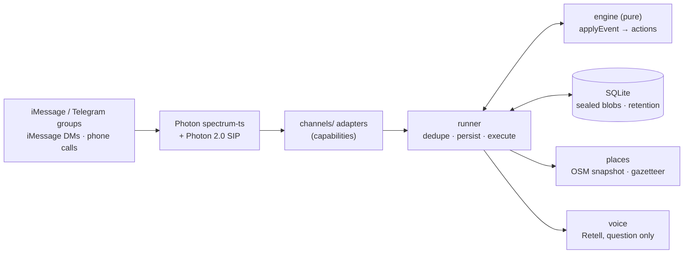

# Otto

**The friend who makes plans happen, then forgets.**

Otto is a privacy-first planning agent that lives inside the group chat you already have. It runs on iMessage, Telegram and real phone calls through [Photon](https://photon.codes). It:
- finds a date without anyone's calendar,
- picks a place to eat,
- checks in with the friends who went quiet (even by phone),
- and then deletes everything.

Built in 36 hours at HackHarvard 2026 for Photon's *Build a Messaging Agent with Photon 2.0* challenge.

---

## The problem

Plans die in the group chat, and friendships die with them.

- Someone says "we should hang out!!". Four people heart it. Two never answer. Nobody wants to be the one who nags, so the thread goes quiet.
- The person who does chase everyone becomes "the organizer". Organizing is unpaid emotional labor, and when the organizer burns out, the group stops meeting.
- An ignored message reads as a small rejection, even when the real reason is a busy week.
- Friends drift from weekly to birthdays-only. Not because of a fight, but because of logistics.
- Polls and calendar links pull the plan out of the chat. New apps ask the whole group to switch, which is one more thing to ignore.

Americans aged 15–24 spent **153 minutes a day** with friends in person in 2003, and **67** in 2019 ([Kannan & Veazie 2023](https://pmc.ncbi.nlm.nih.gov/articles/PMC9811250/), American Time Use Survey). When a request goes to one or two people, **36%** answer; copy 14 or more others and it drops to **14%** ([Blair, Thompson & Wuensch 2005](https://psychology.ecu.edu/wp-content/pv-uploads/sites/216/2019/03/Blair-Thompson-Wuensch-2005.pdf)).

## The idea

An agent that joins the chat you already have and carries the social cost of following up, so no human has to. It picks the date and the place in the thread, then forgets everything. The organizer gets to be a friend again.

**Otto never asks for your calendar.** Nobody keeps their social life in one. Instead it proposes three concrete times, you tap what works, and it decides at a time it announces up front. ([docs/DATE_FINDING.md](docs/DATE_FINDING.md))

## Privacy, in one breath

- **Reads:** Otto skips every message not addressed to it.
- **Stores:** only the plan, sealed with AES-256-GCM, never the conversation.
- **Location:** never asks where you are; it uses only a neighborhood someone types.
- **Cloud LLM:** none by default.
- **Retention:** deletes everything 24 hours after the event.
- **Inspect and delete:** ask *"otto what do you know"* to see everything it has, and *"otto forget"* to delete it.

Full model, with the code that enforces each rule: [docs/PRIVACY.md](docs/PRIVACY.md).

## Try it

```bash
npm install
npm test
npm run sim
```

`npm run sim` is a fully offline group chat with Ana, Ben, Sam, Jo and Maya. Type `ana: @otto dinner next week?` to start; `/help` lists the commands.

To run live on Photon, copy `.env.example` to `.env`, fill in your own Photon project credentials, and pick surfaces (`SURFACES=telegram`, `imessage`, or `imessage-local`). See [docs/CHANNELS.md](docs/CHANNELS.md) for setup, including the voice setup in [docs/VOICE_SETUP.md](docs/VOICE_SETUP.md).

```bash
npm run keys
npm start
```

`npm run keys` prints `DATA_KEY` and `ID_SALT` for your `.env`.

## What it does

| Feature | What it does | Status |
|---|---|---|
| **Calendar-free date finding** | Proposes 3 concrete times; tapbacks or plain words ("fri or sat", "anything but thu", "fri but after 8:30"); quorum, not unanimity, on an announced deadline ([DATE_FINDING.md](docs/DATE_FINDING.md)) | ✅ shipped |
| **Conflict bridges** | Ana only Fri, Ben only Sat → asks for a workable time and adds it as option 4; time shifts; stranded-member question | ✅ shipped |
| **Hungry flow** | One question; tightest budget wins quietly; vetoes; diet notes; meet-in-the-middle for two neighborhoods; exactly 3 options with walk time and hours *at plan time* | ✅ shipped |
| **Transparent nudges** | ≤ 1 unprompted message per 12h, quiet hours 23:00–09:00, ≤ 2 nudges per person, inline-reply addressing, every private check-in announced | ✅ shipped |
| **Voice check-in** | Opt-in call to a quiet member from a Photon 2.0 SMS number via Retell; asks only the open question; answer posted back to the group | ✅ shipped (simulated in `npm run sim`; live needs the [voice setup](docs/VOICE_SETUP.md)) |
| **Call Otto to RSVP** | Inbound call → Retell inbound webhook → Otto asks the caller's open question | ✅ built (webhook mode; not yet tested on a live call) |
| "Where are we at?" | One-message plan card | ✅ shipped |
| Reaction voting | Tapbacks on option bubbles; numbers on plain-text channels; living tally edits | ✅ shipped |
| Smart quiet hours | No unprompted messages 23:00–09:00 in the group's time zone (`otto we're in <city>`) | ✅ shipped |
| Tone dial | `otto tone gentle \| normal \| ruthless` for nudges and the lock | ✅ shipped |
| Weather glance | One rain line in the day-before reminder for outdoor plans (NWS, rounded coordinate only) | ✅ shipped |
| Split the bill | `otto split 142.50 5 ways` (math only, no payments) | ✅ shipped |
| Calendar handoff | `otto add to calendar` → `.ics` (no attendees) or a text block; no calendar access | ✅ shipped |
| Threshold mode | `otto lock it when 4 say yes` | ✅ shipped |
| Veto and swap | "can't do friday anymore" reopens only the date; place and notes kept | ✅ shipped |
| Reminder ladder | Day-before and hour-before, once each, with address and maps link | ✅ shipped |
| Plan-scoped notes | `otto note parking: behind the building` / `otto what did we decide about parking` | ✅ shipped |
| Multi-group isolation | Same person in two groups → two unlinked IDs and plans (tested) | ✅ shipped |
| Explain yourself | `otto why` shows the tally and any low-confidence reads | ✅ shipped |
| Notice mode | Opt-in: offers once per 24h when "we should hang out" appears | ✅ shipped |
| What do you know / forget / stop | Full dump; delete now; delete and leave (tombstone where leaving is impossible) | ✅ shipped |
| Optional hosted-LLM fallback | Off by default; redacted snippet only, for replies the local parser can't read | ✅ shipped (off) |
| Live Photon surfaces | Telegram, dedicated / local iMessage, shared-line DMs, terminal adapters on spectrum-ts 12.11.0 | ⚠️ built and tested against the SDK's typings with a fake SDK; live verification is Saturday's first task |
| Interactive iMessage cards | One-tap pickers via the iMessage apps extension | 📝 planned |
| Email digest, WhatsApp 1:1 check-ins | Extra Photon channels | 📝 planned |

## What we measured

Ten role-play group chats ([eval/fixtures](eval/fixtures/README.md)) were written **blind** from our spec. The author was a separate AI agent that could read only `docs/`, never `src/`, so the labels say what the spec promises, not what the code does. `npm run eval` replays them through the **real** stack: the simulator, runner, engine, encrypted store, scheduler on a fake clock, offline places and a mocked call. It also scans every log line and every database value for leaks.

| Metric | Result |
|---|---|
| Date replies: per-day votes read correctly | **98.5%** (135 day-cells in 45 messages) |
| Date replies: whole message exactly right | 95.6% |
| Correct final date | **10/10** fixtures |
| Correct lock reason (everyone / deadline / threshold / forced) | 10/10 |
| Food-intent precision / recall | **100.0% / 87.9%** (183 labeled messages) |
| Hungry flow triggered exactly when it should | 10/10 |
| Recommendation matches stated cuisine and budget | 3/4 |
| Message intent accuracy (7 classes) | 95.6% |
| Unprompted group messages sent (all fixtures) | 5; noise budget respected in 10/10; quiet-hour violations 0 |
| Log lines with message text, phone numbers, emails or handles | **0** of 502 |
| Database values containing plaintext message text or numbers | **0** |

| Fixture | Final date | Lock | Hungry | Place | Unprompted (max/12h) | Date cells | Errors |
|---|---|---|---|---|---|---|---|
| 01-happy-path-thai | ✓ fri | ✓ everyone | ✓ | ✗ Bon Me | 2 (1) | 15/15 | 0 |
| 02-food-idioms-forced-lock | ✓ thu | ✓ forced | ✓ | – my apt | 0 (0) | 15/15 | 0 |
| 03-conflict-bridge | ✓ sat | ✓ everyone | ✓ | – ben's apt | 0 (0) | 15/15 | 0 |
| 04-time-shift-ruthless-deadline | ✓ fri | ✓ deadline | ✓ | – the pub on mass ave | 2 (1) | 17/18 | 0 |
| 05-threshold-hungry-midpoll | ✓ fri | ✓ threshold | ✓ | ✓ Tabla Express | 0 (0) | 12/12 | 0 |
| 06-silent-member-call | ✓ fri | ✓ everyone | ✓ | – lily's apartment | 1 (1) | 12/12 | 0 |
| 07-veto-after-confirm | ✓ sat | ✓ everyone | ✓ | ✓ Hokkaido Ramen Santouka | 0 (0) | 24/24 | 0 |
| 08-hackathon-instant-meet-middle | ✓ sat | ✓ none | ✓ | ✓ Dolphin Bay | 0 (0) | 0/0 | 0 |
| 09-privacy-forget-stop | ✓ none | ✓ none | ✓ | –  | 0 (0) | 9/9 | 0 |
| 10-quiet-hours-late-night | ✓ wed | ✓ everyone | ✓ | –  | 0 (0) | 14/15 | 0 |

**How to read it:**
- **Small and spec-derived.** Ten conversations (183 labeled messages) are a sanity check, not a benchmark.
- **The one recommendation miss is a data gap, not a parsing bug.** Our OpenStreetMap snapshot has no Thai restaurant within walking distance of Harvard Square. Otto says so in the thread and offers the closest alternatives.
- **Food recall is 87.9% by design.** Unaddressed food talk only starts the hungry flow when both the rules and the local classifier agree. False positives are worse than misses, and precision is 100%.
- **The privacy rows check exact strings.** The checker looks for every message, phone number and email in the fixtures, in their written and digits-only forms, across all log output and every database cell. Plan data is sealed with AES-256-GCM, so nothing readable is stored.

Unit tests: **289 passing** (`npm test`) across the engine, store, privacy, runner, channels, places, voice and the LLM gate.

## What is simulated

- **Offline simulator** (`npm run sim`): a stand-in group chat for when the venue network fails. In it the phone call is **mocked** and labeled "(simulated call)".
- **Restaurant price bands** are our team's estimates ("~$ (est.)"), because OpenStreetMap has no prices. Names, cuisines, addresses and opening hours come from OpenStreetMap.
- **Clock fast-forward:** in the live demo we fast-forward the clock to show a 24-hour nudge, and we say so when we do it.

## How it works



- **Architecture:** [docs/ARCHITECTURE.md](docs/ARCHITECTURE.md)
- **State machine:** [docs/STATE_MACHINE.md](docs/STATE_MACHINE.md)
- **Hungry flow:** [docs/HUNGRY_FLOW.md](docs/HUNGRY_FLOW.md)
- **Features (shipped / planned):** [docs/FEATURES.md](docs/FEATURES.md)

## Research

- **Fenn** (YC F26, which inspired the concept): [research/fenn-concepts.md](research/fenn-concepts.md), and why it likely pivoted to couples in [research/fenn-pivot.md](research/fenn-pivot.md). We used public sources only and reused no Fenn name, copy or assets.
- **Photon's capabilities**, verified against docs and SDK source: [research/photon-capabilities.md](research/photon-capabilities.md) and [research/platform-setup.md](research/platform-setup.md).
- **Evidence for the problem:** [research/problem-evidence.md](research/problem-evidence.md).
- **Places API evaluation:** [research/places-api.md](research/places-api.md).
- **All sources and assumptions:** [NOTES.md](NOTES.md).

## Credits

- **Map data** © OpenStreetMap contributors, [ODbL 1.0](https://www.openstreetmap.org/copyright).
- **Weather:** US National Weather Service API.
- **Messaging and voice:** Photon. **Voice agent:** Retell.

## License

MIT
