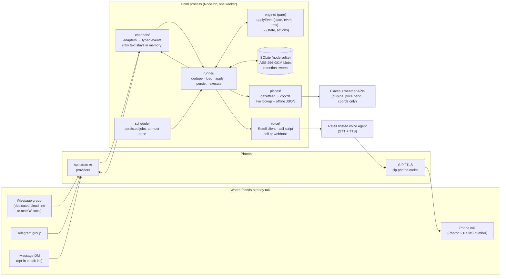

# Homi architecture



## Principles that shape the code

1. **The engine is pure.** `applyEvent(state, event, ctx) -> { state, actions }` does no I/O, reads no clock (`ctx.now`), and holds no message text in state. Every behavior in STATE_MACHINE.md is unit-testable with plain objects, and the eval harness replays whole conversations in milliseconds.
2. **Async work is an action, and its result is an event.** Places, weather, calls and message-ID capture work the same way:
   - The engine emits `lookup_places`, `lookup_weather` or `call`.
   - The runner does the I/O.
   - The result comes back as `places_result`, `weather_result`, `call_result` or `sent`.
   - So the engine stays deterministic.
3. **Adapters are thin.** Only `src/channels/` imports Photon. Each adapter does two things:
   - **Inbound:** turns `[space, message]` into a `ChannelInbound` with a hashed member key, `addressed` / `replyTo` / reaction info, and the text as a transient field.
   - **Outbound:** maps actions to `space.send`, `message.reply`, `react`, `edit`, polls, files and `leave`.
   - Each adapter declares a `Capabilities` object. The engine reads that object to decide how to render a feature (option bubbles vs poll vs numbered text).
4. **One process, one replica, outbound connections only.**
   - `app.messages` holds the Photon streams (gRPC for iMessage, WebSocket for Telegram).
   - A small `node:http` server serves `/health`. In webhook mode it also serves `/voice/retell`.
   - Render and Railway both work as long as the dyno doesn't sleep.
5. **Offline first.**
   - `npm run sim` runs the entire product with no network. It uses an in-process group-chat simulator with personas, a fast-forwardable clock, the offline places JSON, and a mock voice call (clearly labeled).
   - `SURFACES=terminal` uses spectrum-ts's terminal provider with a `name: text` persona shim. Its first run needs to download the `tuichat` binary, so pre-cache it.

## Directory map

```
src/
  index.ts            boot: config → store → adapters (SURFACES) → runner → scheduler → http
  config.ts           env parsing and defaults
  engine/             PURE, no imports outside engine/
    types.ts          GroupState, Plan, Member, Option, EngineEvent, Action, Ctx, Capabilities
    plan.ts           applyEvent: the state machine
    parse.ts          classify(): command / plan / food / vote grammar (DATE_FINDING.md §3)
    schedule.ts       option generation, deadlines, choose, bridges
    nudge.ts          noise budget, quiet hours, escalation ladder, tone
    hungry.ts         food intent, taste merge, ranking, compromise copy
    classifier.ts     naive-Bayes intent model + weights (local "small model")
    templates.ts      every user-facing string (tone variants); sentence linter
    dump.ts           "what do you know" from state
    ics.ts            .ics and text calendar block
  channels/
    types.ts          ChannelAdapter, ChannelInbound, Capabilities per surface
    spectrum.ts       Spectrum() bootstrap, telemetry off, [space,message] → ChannelInbound
    imessage.ts       cloud (shared / dedicated) and local capability profiles
    telegram.ts
    terminal.ts       persona shim for the tuichat terminal provider
    sim.ts            in-process multi-persona group simulator (no Photon)
  runner/
    runner.ts         inbound pipeline and event loop
    executor.ts       action → adapter calls; records sent message refs
    scheduler.ts      claims due jobs (pending → firing → done); never re-fires
    clock.ts          system clock + fake clock (/ff 12h)
  store/
    db.ts             node:sqlite, migrations, WAL
    schema.sql
    repo.ts           load/save GroupState (encrypted blob), jobs, delivery, seen
  privacy/
    ids.ts            HMAC member and space keys
    crypto.ts         AES-256-GCM seal/open
    redact.ts         phone / email / handle / long digit scrubbing
    logger.ts         redacting structured logger
    retention.ts      sweep + purge + VACUUM
  places/             see HUNGRY_FLOW.md
  voice/              Retell client, call script, poll + webhook, mock
  llm/redacted.ts     optional hosted fallback; off unless DISABLE_HOSTED_LLM=false
  http/server.ts      /health, /voice/retell
  cli/sim.ts          interactive offline demo
  cli/keys.ts         generates DATA_KEY and ID_SALT
eval/
  fixtures/*.json     10 role-play conversations, labeled
  run.ts              metrics → eval/results.json + README table
test/                 vitest unit tests per module
```

## Extensions: bills, travel, pledges, album

The core state machine stays untouched. Each feature plugs in through `src/engine/ext/types.ts`, and modules are registered in `src/engine/ext/index.ts`.

| Hook | What it does |
|---|---|
| `onMessage` | Sees every message before the built-in commands |
| `onEvent` | Handles `photo`, `travel_result`, `payment_result`, and reactions on the extension's own bubbles |
| `onTimer` | Handles `ext` jobs |
| `onSent` | Captures the IDs of tagged sends |
| `onForget` / `onStop` | Cleans up, e.g. refunds open pledges and deletes photos |
| `dump` | Adds lines to "what do you know" |

Where the data lives:
- **Group-level** data goes in `GroupState.space.ext`, sealed with the settings: the bill tab, trip and album index.
- **Plan-level** data goes in `Plan.ext`: the pledge.

**Runner side.** `src/runner/handlers/` executes the extension actions:
- `lookup_travel` → travel provider
- `payment` → payment provider (simulated by default)
- `album_keep` / `album_delete` → encrypted photo store

Incoming photos go straight to the photo store; the engine only ever sees an opaque photo ID.

## Storage

Storage is SQLite through Node 22's built-in `node:sqlite`. It needs no native compile, which matters on Windows and Render.

| Table | Columns | Notes |
|---|---|---|
| `spaces` | `space_key` (HMAC), `platform`, `settings_blob` (sealed: tone, tz, notice, headcount, intro_sent), `muted`, `updated_at` | `muted=1` is the tombstone after `stop` on platforms that can't leave |
| `plans` | `plan_id`, `space_key`, `state`, `event_at`, `purge_at`, `blob` (sealed JSON of the whole plan aggregate) | The whole plan, including members, votes, names and the neighborhood, is encrypted as one blob. Only routing and retention columns are plaintext. |
| `delivery` | `member_key`, `plan_id`, `handle_sealed` | Raw phone/handle for DMs and calls. Deleted with the plan. |
| `jobs` | `job_key` (unique), `plan_id`, `kind`, `due_at`, `status`, `payload` | `payload` never holds personal data |
| `seen` | `msg_hash`, `seen_at` | Inbound dedupe (SHA-256 of platform message ID), with a 24h TTL |

There is **no column anywhere that can hold message text.** `test/store/schema.test.ts` asserts this.

**Encryption.**
- `DATA_KEY` is 32 random bytes, base64-encoded. Each blob is sealed with AES-256-GCM using a random 12-byte nonce.
- `ID_SALT` keys the HMAC-SHA256 used for member and space keys.
- `npm run keys` prints fresh values for `.env`.

## Exactly-once-ish

- **Inbound.** Dedupe on `sha256(platform + message.id)` before anything else. That covers at-least-once delivery and reconnect replays.
- **Outbound scheduled messages are at-most-once.**
  1. The scheduler claims a job (`UPDATE … SET status='firing' WHERE status='pending'`).
  2. It runs the timer event through the engine.
  3. It executes the actions and marks the job `done`.
  - A crash between steps 1 and 3 leaves the job `firing`. At startup, `firing` jobs older than 2 minutes are marked `failed` and **not** re-sent. A missed reminder is better than a double message.
- **Job keys** are deterministic (`{planId}:remind:day`), so rescheduling the same reminder replaces it instead of duplicating it.

## Voice path (docs/CHANNELS.md has the setup)

1. The engine emits `{ type: 'call', member, question, options, callRef }`, always alongside a group `send` announcing the call.
2. `voice/retell.ts` calls Retell's `create-phone-call`:
   - `from_number` is the Photon 2.0 SMS number.
   - `to_number` comes from the encrypted delivery lookup.
   - The dynamic variables are `{question, options}` only.
3. **Result retrieval, two modes:**
   - **Poll mode (default, no public URL needed):** poll `get-call` until `call_analysis` is present.
   - **Webhook mode (deployed):** `/voice/retell` verifies the signature, then reads `call_analyzed`.
4. The answer is mapped to option IDs by the same reply grammar used for text, then fed back as a `call_result` event. Homi then posts in the group: "Sam's in for Fri (by phone). 6 for 6 🎉"
5. **`VOICE_MODE=mock`** simulates the call for the offline demo and is labeled "(simulated call)" in the transcript.

## Configuration (`.env.example`)

| Var | Default | Meaning |
|---|---|---|
| `SURFACES` | `sim` | comma list: `sim`, `terminal`, `imessage`, `imessage-local`, `telegram` |
| `SPECTRUM_PROJECT_ID`, `SPECTRUM_PROJECT_SECRET` | none | Photon (Stable) project for spectrum-ts |
| `SPECTRUM_IMESSAGE_LINE` | `shared` | `shared` or `dedicated` (capability profile) |
| `SPECTRUM_TELEGRAM_*` | none | see CHANNELS.md |
| `SPECTRUM_WEBHOOK_SECRET` | none | only if using Photon webhooks |
| `PHOTON_VOICE_NUMBER` | none | the Photon 2.0 SMS number used for calls (E.164) |
| `RETELL_API_KEY`, `RETELL_AGENT_ID` | none | voice |
| `VOICE_MODE` | `mock` | `mock`, `poll`, `webhook` |
| `PLACES_PROVIDER`, `PLACES_API_KEY` | see HUNGRY_FLOW.md | |
| `DISABLE_HOSTED_LLM` | `true` | must be `false` **and** a key set before any hosted call |
| `ANTHROPIC_API_KEY` | none | only for the optional redacted fallback |
| `RETENTION_HOURS` | `24` | after event time |
| `QUIET_HOURS` | `23-9` | group-local |
| `DEFAULT_TZ` | `America/New_York` | |
| `DATA_KEY`, `ID_SALT` | none | `npm run keys` |
| `DB_PATH` | `./data/wtw.db` | |
| `LOG_LEVEL` | `info` | |
