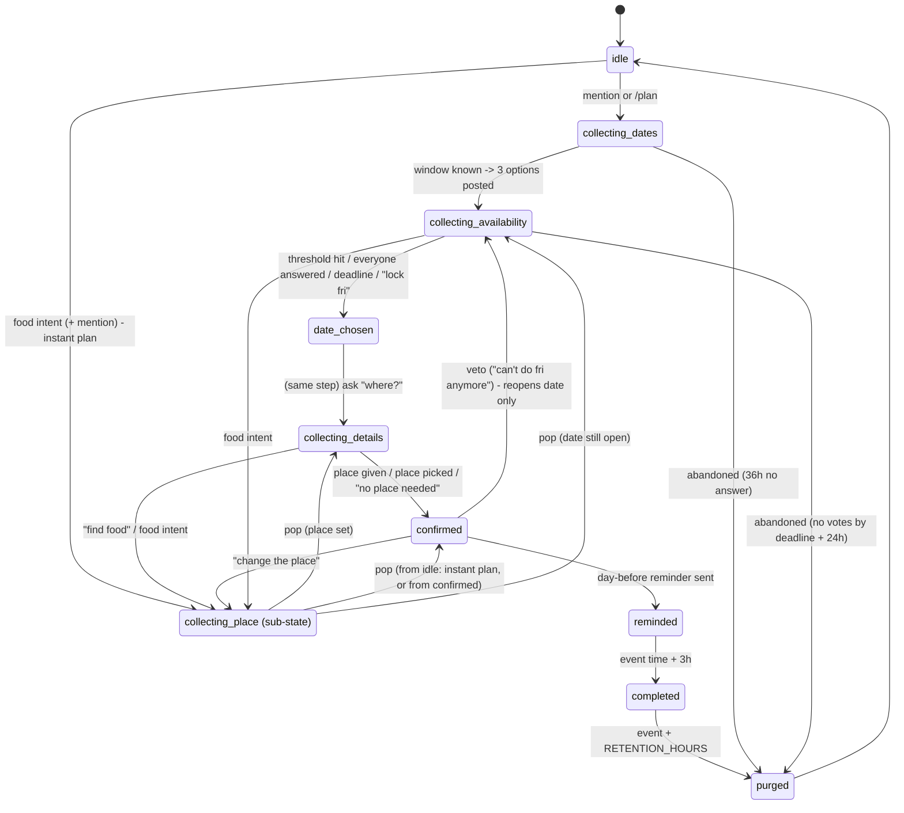

# Homi plan state machine

The engine is a pure function: `applyEvent(state, event, ctx) -> { state, actions }`. It has no I/O and no clock reads, because `ctx.now` is passed in. Every rule below is enforced in `src/engine/plan.ts` and covered by tests in `test/engine/`.

## Hard rules (apply in every state)

1. **Two sentences max.** No agent message has more than two sentences. Option lists are sent as one short bubble per option, each bubble a fragment. A test lints every template.
2. **Noise budget.** Homi sends at most **one unprompted message per group per rolling 12 hours**. An unprompted message is allowed when at least 12h have passed since the last one; exactly 12h is fine.
   - *Prompted* means one of the following:
     - a direct reply to a member's message;
     - the intro, which answers the first message Homi sees;
     - anything that concludes a flow a member started in the last 30 minutes (hungry-flow results, place lock);
     - the result of a call the group was told about;
     - a reminder that a member explicitly asked for (`homi remind me`);
     - a `stop` or `forget` confirmation;
     - an update in a pledge the participants opted into: the check-in milestone, the settlement, a dispute outcome (COMMITMENTS.md).
   - Everything else the scheduler fires is *unprompted*: the availability nudge, deadline locks, the day-before and hour-before reminders, and the details nudge.
   - When two unprompted messages would collide, they are **merged** into one message. If they can't be merged, the lower-priority one is dropped. Priority, highest first: hour-before reminder, day-before reminder, deadline lock, nudge.
3. **Quiet hours.** No unprompted message is sent between 23:00 and 09:00 in the group's time zone (default `America/New_York`; change with `homi we're in <city>`). A job that falls in quiet hours moves to 09:00, or is merged.
4. **Silence until invited.** Before a plan exists, Homi only answers the following:
   - its name
   - slash commands
   - `homi privacy`
   - `homi stop`
   - The one exception is the intro (see PRIVACY.md §1).
5. **Stop always works.**
   - `homi stop`, from any member in any state, deletes everything for this chat and makes Homi leave. Where leaving isn't possible, Homi tombstones the chat instead.
   - `homi forget` deletes the current plan and keeps Homi in the chat.
6. **Group-visible.** Every DM or call action is emitted together with a group message announcing it (PRIVACY.md §6).

## Diagram

Any state goes to `purged` on `homi forget` or `homi stop`.

`collecting_place` is a sub-state with a **return stack**. Entering it pushes the current state, and finishing it pops back. If the popped state was `collecting_details`, the engine immediately advances to `confirmed` because the place is now set. The full flow is in [HUNGRY_FLOW.md](HUNGRY_FLOW.md).

---

## States

Copy is shown for the default **normal** tone. Tone variants for nudges are in [Tone dial](#tone-dial). Placeholders look like `{this}`.

### `idle`

No active plan in this chat.

- **On entry:** nothing. After an automatic purge Homi stays silent. After `homi forget` it says "Done: I've deleted this plan."
- **Moves forward on:**
  - **Plan intent with a mention or `/plan`** (e.g., "@homi dinner next week?") → `collecting_dates`.
  - **Food intent with a mention** (e.g., "homi where should we eat") → `collecting_place` with an *instant plan* (today, around now).
  - **Notice mode on** (opt-in, off by default): a "we should hang out" message → Homi may offer **once per 24h**: "Want me to make that happen? Reply "homi yes" and I'll find a date."
- **Nudges:** none, ever.
- **`stop`:** purge (nothing to purge) and leave.

### `collecting_dates`

A plan has started, but Homi doesn't yet know *when-ish*.

- **On entry:**
  - If the trigger already named a window ("next week", "this weekend", "friday", "tomorrow"), Homi skips this state in the same step and posts options. See `collecting_availability`.
  - Otherwise it asks: "I'm in. Roughly when: this week, this weekend, or next week?"
- **Moves forward on:** any reply that names a window → generate 3 options → `collecting_availability`.
- **Nudges:** one, 12h after entry: "Still up for {activity}? Just tell me when-ish."
- **Abandonment:** after 36h with no answer, Homi purges silently.
- **`stop`:** purge and leave.

### `collecting_availability`

Three options are posted and people are answering.

- **On entry:**
  - **Header:** "{Activity}, {window}. Tap ❤️ on every time that works (or reply like "fri or sat"); I'll lock it in {deadline}."
  - **Option bubbles:** "1 · Thu Oct 22 · 7pm", "2 · Fri Oct 23 · 7pm", "3 · Sat Oct 24 · 7pm".
  - **Native poll:** where the channel has native multi-answer polls (Telegram, and iMessage on iOS 26 if supported), the options go out as a poll.
- **What counts as an answer:** see [DATE_FINDING.md](DATE_FINDING.md). Every member gets a vote of yes, maybe, no, or unknown per option.
- **Moves forward on:**
  1. **Threshold mode.** The threshold is set with "lock it when 4 say yes", and an option reaches it → `date_chosen` early.
  2. **Everyone answered.** Every *known* member has answered, and there are at least 2 → `date_chosen`.
  3. **Forced lock.** A member says "homi lock fri" → `date_chosen` with that option. Homi notes who asked in the tally explanation.
  4. **Deadline reached** → choose (DATE_FINDING.md §4) → `date_chosen`.
     - If there is a **conflict**, Homi posts one bridge question instead and waits up to 6 more hours (DATE_FINDING.md §5).
- **Nudges (one unprompted message, at 50% of the window):**
  - It is scheduled only if the deadline is still at least 12h after it. In shorter windows, the deadline lock is the only unprompted message.
  - **Collective:** "{k} of {n} have picked. Still need {names_or_count}; I'm locking it in {deadline}."
  - **Single pending member:** if exactly one known member is pending and has a stored last-message ID, the nudge is an **inline reply to that member's own last message**. That addresses them without printing a name or number.
  - **Escalation, folded into the same message:** for pending members who **opted in** to calls or DMs, the nudge says "Still need Sam, so I'm giving them a quick call (they said that's ok)." The call or DM action is emitted in the same step.
  - **Short windows (no 50% nudge):** the escalation happens at the deadline instead, as that deadline's one unprompted message ("Still need Sam before I lock it in, so I'm giving them a quick call (they said that's ok).") with the call or DM in the same step. The lock follows as a prompted message when the result arrives, or after 10 minutes ("Couldn't reach Sam; going with Fri.").
  - At most **2 nudges per member per plan**, ever.
- **`stop`:** purge and leave. A member's "I'm out" marks only that member out: no votes, no nudges, no guilt.

### `date_chosen`

This is a transient announcement state. It enters and leaves in the same `applyEvent` call.

- **On entry:** "{Day date time} it is: {yes} in{, maybe_count maybe}. Where to? Say "homi find food" for 3 options, or tell me the spot."
- If the place is already set (because the hungry flow ran earlier), Homi goes straight to `confirmed`.
- **Moves forward:** immediately → `collecting_details`.

### `collecting_details`

The date is set. Homi still needs a place, plus any plan notes.

- **Moves forward on:**
  - **The place given as text**, e.g. "at Ana's", or a venue name, captured with "homi we're going to {X}" or "homi place: {X}" → `confirmed`.
  - **"homi find food" or food intent** → push `collecting_place`.
  - **"no place needed" or "we'll figure it out"** → `confirmed` with no place.
- **Nudges:** one, 12h after entry, and only if the event is more than 24h away: "Still need a spot for {day}; want 3 options?"
  - If the event is less than 24h away, Homi confirms without a place at the day-before reminder.
- **`stop`:** purge and leave.

### `collecting_place` (sub-state)

This is the hungry flow. Full detail is in [HUNGRY_FLOW.md](HUNGRY_FLOW.md).

- **On entry:** "What are we feeling? Cuisine, budget, and roughly where?"
- **Moves forward on:** answers collected → 3 options → votes → winner → `place` set → **pop**.
- **Nudges:** none. Food is time-sensitive, so after 10 minutes Homi recommends with whatever answers it has.
- **`stop`:** purge and leave.

### `confirmed`

- **On entry:** the plan card.
  - "Locked: {Fri Oct 23, 7pm} · {Tasty Thai, 1234 Mass Ave} · {4} in, {1} maybe. I'll remind you the day before; say "homi add to calendar" for an invite."
- **Moves forward on:** the day-before reminder job firing → `reminded`.
- **Also handles:**
  - **Veto and swap.** "can't do friday anymore" from a *yes* voter → Homi reopens **only the date**. It posts 3 fresh options without Friday, keeps the place, and goes back to `collecting_availability`.
  - **"I'm out"** marks that member out.
  - **"change the place"** → push `collecting_place`.
  - **"homi add to calendar"** → `.ics` attachment where the channel supports files, or a plain text block otherwise.
- **Nudges:** none. Only reminders.

### `reminded`

- **On entry:** the day-before reminder: "Tomorrow {7pm}: {Tasty Thai}, {1234 Mass Ave} · {maps link}."
  - Add one rain line if it applies (see FEATURES.md, Weather glance).
- **Hour-before reminder:** "1 hour to go: {Tasty Thai}, {address} 🍜 After, "homi split 120" splits the bill."
- Each reminder is sent **once**. The reminder ladder is idempotent via job keys.
- **Moves forward on:** event time + 3h → `completed`.

### `completed`

- **On entry:** silent. The noise budget wins, and the hour-before reminder already mentioned the bill split.
- **Handles:**
  - **"homi split 142.50"**, or "homi split 142.50 5 ways", replies "$28.50 each for 5 people (tip not included)." With no "ways" given, it splits by the yes count.
  - **"homi what do you know"** shows the dump.
- **Moves forward on:** event + `RETENTION_HOURS` (default 24) → `purged`.

### `purged`

- **On entry:** delete every row for the plan, the delivery lookup, and pending jobs, then `VACUUM`.
  - **Automatic purge:** silent.
  - **`homi forget`:** "Done: I've deleted this plan."
  - **`homi stop`:** "Deleted everything for this chat. Bye 👋", then leave or tombstone.
- **Moves forward:** immediately → `idle`.

---

## Commands (any state, case-insensitive)

Homi is triggered by `homi …`, an `@homi` mention, a reply to a Homi message, or a `/command`.

| Command | Effect |
|---|---|
| `/plan`, `homi dinner next week?` | Start a plan |
| `homi where are we at`, `/status` | One-message plan card: date, place, who's in, who's pending |
| `homi find food`, `/food`, `homi where should we eat` | Hungry flow |
| `homi lock it when 4 say yes`, `/threshold 4` | Threshold mode |
| `homi lock fri` | Force-lock an option |
| `homi why fri`, `homi explain` | Tally explanation ("Fri had 4 yes + 1 maybe; Sat had 3 yes, 2 no") |
| `homi I'm Sam` | Set the name Homi uses for you (encrypted, purged with the plan) |
| `I'm out`, `count me out` | Opt out of this plan |
| `homi you can DM me`, `homi you can call me` | Private check-in opt-in (per member, per plan) |
| `homi tone gentle\|normal\|ruthless` | Tone dial |
| `homi note parking: behind the building` | Plan-scoped note |
| `homi what did we decide about parking` | Answer from plan notes only |
| `homi add to calendar`, `/ics` | Calendar handoff (no calendar access) |
| `homi split 142.50 [n ways]`, `homi itemize …`, `homi settle up` | Bill splitting with tip/tax/fees and several payers ([BILLS.md](BILLS.md)) |
| `homi what do you know` | Full data dump plus a delete offer |
| `homi forget` | Delete the plan now |
| `homi stop` | Delete everything and leave |
| `homi privacy` | Two-sentence privacy summary plus a link to PRIVACY.md |
| `homi notice on\|off` | Opt-in: offer help when a plan is forming |
| `homi we're in {city}` | Set the time zone for quiet hours |

## Tone dial

Tone affects **nudges and the deadline lock only**. Privacy messages, stop messages and errors are always plain.

| Template | gentle | normal | ruthless |
|---|---|---|---|
| nudge, collective | "No rush! {k} of {n} have picked; tap a time above when you get a sec 💛" | "{k} of {n} have picked. Still need {who}; I'm locking it in {deadline}." | "Day {d}. {who} {has/have} said nothing. The group waits; I lock {deadline} regardless." |
| nudge, individual (inline reply) | "Hey, no pressure: does Thu, Fri or Sat work for you?" | "Thu, Fri or Sat? Tap a time above." | "Still waiting on you. Thu, Fri or Sat; choose wisely." |
| deadline lock | "Going with {day}! {yes} can make it 💛" | "{day} it is: {yes} in." | "Time's up. {day} it is; {absent} will hear about this." |

## Event and action types

These are summarized here. They are canonical in `src/engine/types.ts`.

- **Events:**
  - `message` (classified: `command`, `plan_intent`, `food_intent`, `vote_reply`, `food_answer`, `veto`, `chatter`)
  - `reaction` (add/remove, target Homi message)
  - `poll_vote`
  - `member_seen`
  - `added_to_group`
  - `timer` (job fired)
  - `call_result` (voice answer)
- **Actions:**
  - `send` (group)
  - `reply` (inline reply to a message ID)
  - `dm`
  - `call`
  - `react`
  - `edit` (update a living tally message, where edits are supported)
  - `schedule`
  - `cancel`
  - `purge`
  - `leave`
  - `tombstone`
