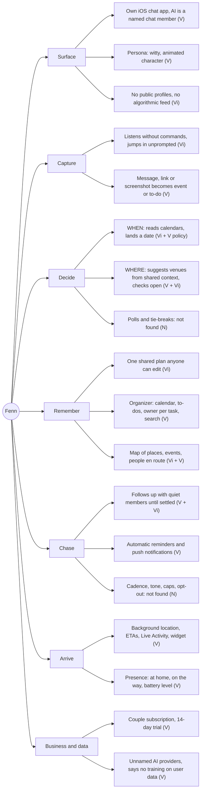
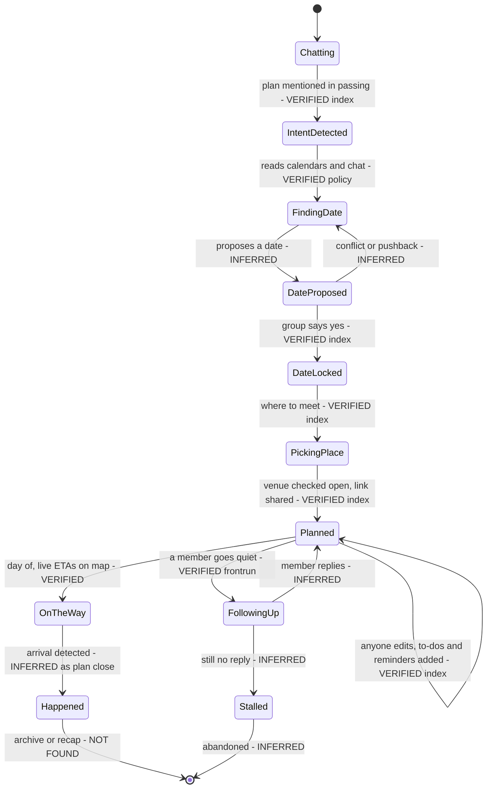

# Fenn: product concepts (competitive research)

Researched 2026-10-16 for HackHarvard 2026. Public sources only: no logins, no accounts, no app install, no decompiling, no server probing. Fenn's copy is paraphrased throughout. The few direct quotes are marked and linked.

**Evidence tags used below**
- **VERIFIED (live):** read on the live page on 2026-10-16. URL given.
- **VERIFIED (index):** seen only in web-search index excerpts of a page whose live version has since changed or now redirects (askfenn.to, older App Store names, the founder's X bio). It is weaker than a live read because the text reached us as search excerpts, not a page load.
- **INFERRED:** our own reasoning. Fenn does not say it.
- **NOT FOUND PUBLICLY:** we looked and found nothing. What we checked is listed.

## TL;DR (what matters for our build)
1. **Fenn is a standalone iOS chat app, not a bot inside iMessage or WhatsApp.** Its Terms call it "Fenn is an AI-assisted group chat." ([fenn.chat/l](https://fenn.chat/l)). We found no evidence that it ever ran inside someone else's messenger. Zero-install, in-thread use is our clearest point of difference.
2. **Fenn has pivoted from group plans to a paid couples organizer.** askfenn.to now 308-redirects to fenn.chat. The same App Store ID has gone from a group chat that turns plans into reality to a "Life organizer" for two partners, with a couple subscription at $14.99 a month.
3. **Fenn is built around location.** It uses background location, arrival detection, live ETAs, Live Activities, shared battery levels and 3D maps. The founder led Zenly's map effort. Our default of no location is a real differentiator.
4. **Fenn finds dates by reading calendars (device calendar plus Google Calendar sync), not by polling.** We found no polls, no tie-break rule and no handling for answers like "I can do either". We have to design those ourselves.
5. **Fenn's privacy story has gaps.** The policy names no AI or LLM vendor, and messages are kept for as long as the account is active. The App Store label lists Identifiers under "Data Used to Track You", and it lists Contacts even though the policy says Fenn does not access the address book.

---

## 1. Concept map

Legend: V = verified (live), Vi = verified (index), N = not found publicly.

---

## 2. Answers to the nine questions

### Q1. Core loop: from "someone suggests a hangout" to "everyone shows up"
Fenn does not publish an ordered list of steps. We pieced the sequence together from the steps it does describe, so **the ordering is INFERRED**, while each step is tagged on its own.

| # | Who | Step | Tag | Source |
|---|---|---|---|---|
| 0 | Human | Everyone installs the iOS app and joins a shared Fenn space or chat. In the current product you download the app and invite your partner. In the group era, you added Fenn to a conversation with friends and kept talking normally. | VERIFIED (live) for current; VERIFIED (index) for group era | https://fenn.chat/fair-questions ; https://www.askfenn.to/ |
| 1 | Human | Someone floats a loose plan in passing, such as a cabin weekend, a school pickup or "drinks soon". | VERIFIED (index) | old listing "Fenn: Chat that thinks", https://apps.apple.com/us/app/fenn-chat-that-thinks/id6761315757 |
| 2 | Agent | Picks up the intent without a command, and may jump in with an answer or action before anyone asks. | VERIFIED (index) | https://www.askfenn.to/ |
| 3 | Agent | Checks everyone's availability and settles on a date without back-and-forth. Mechanism: device-calendar reading plus optional Google Calendar sync. | VERIFIED (index) for the claim; VERIFIED (live) for the mechanism | https://www.askfenn.to/ ; https://fenn.chat/l |
| 4 | Human | The group accepts. A testimonial says the group simply said yes. | VERIFIED (index) | https://www.askfenn.to/ |
| 5 | Agent | Proposes a meeting place, checks that it is open, and shares a link. | VERIFIED (index) | https://www.askfenn.to/ (testimonial from an 8-person group) |
| 6 | Agent | Sends invites, books (a pickleball court in one testimonial) and sets reminders. How it books is NOT FOUND PUBLICLY. | VERIFIED (index) | https://www.askfenn.to/ |
| 7 | Agent | Turns casual asks (e.g., someone should bring the net) into tracked to-dos with reminders. Once a time is proposed, it creates the invite and reminder automatically. | VERIFIED (index) | https://www.askfenn.to/ |
| 8 | Agent | Keeps one shared plan that every member can view and update, with places, events and people on the way shown on one map. | VERIFIED (index) | https://www.askfenn.to/ |
| 9 | Agent | Follows up with members who stop replying, and keeps going until the plan is settled. | VERIFIED (live) + VERIFIED (index) | https://www.frontrun.vc/blog/yc-f26-companies-full-list ; https://www.askfenn.to/ |
| 10 | Agent + Human | On the day: live ETAs, arrival and departure detection, and a Live Activity that follows the trip. | VERIFIED (live) | https://fenn.chat/l ; https://apps.apple.com/us/app/fenn-life-organizer/id6761315757 |
| 11 | Human | People arrive. What happens to the plan afterwards (archive, recap, deletion) is NOT FOUND PUBLICLY. | NOT FOUND | checked fenn.chat, /fair-questions, /l, App Store description and version notes |

### Q2. Date finding
- **Calendar access is the main mechanism. VERIFIED (live).** With permission, the privacy policy says Fenn reads the device calendar to detect scheduling intent. It also reads your Google Calendar list and reads and writes events in the calendars you enable for sync. https://fenn.chat/l. Version notes from late September 2026 add viewing a partner's shared calendars and choosing which of your own to share. https://apps.apple.com/us/app/fenn-life-organizer/id6761315757
- **Inference from chat. VERIFIED (live).** Fenn's AI analyzes conversation content, calendar events and location patterns to surface coordination suggestions. https://fenn.chat/l. The group-era site said it checks everyone's availability and lands a date. VERIFIED (index). https://www.askfenn.to/
- **Polls: NOT FOUND PUBLICLY.** We checked the fenn.chat home page, /fair-questions, /l, the current App Store description and visible version history, and search excerpts of askfenn.to and the older App Store names. None mention polls or votes.
- **Tie-breaking: NOT FOUND PUBLICLY** (same sources).
- **"I can do either": NOT FOUND PUBLICLY** (same sources).
- **INFERRED:** Because the design is calendar-first, free/busy data probably decides most dates, and anyone without a connected calendar answers in chat for the model to interpret. Fenn does not document this.

### Q3. Plan memory
- **Group era. VERIFIED (index).** The conversation becomes one shared plan that every member can see and update, combining events, to-dos and locations, with a map of places, events and people en route. https://www.askfenn.to/
- **Current app. VERIFIED (live).**
  - The "Organizer" screen has Calendar and To-dos tabs, and to-dos have due dates (https://fenn.chat/).
  - A shared view shows upcoming plans and who is handling each task (App Store description).
  - Messages, links or screenshots become calendar events (https://fenn.chat/).
  - Addresses and calendar links are tappable, and place panels show visits and photos (version notes, https://apps.apple.com/us/app/fenn-life-organizer/id6761315757).
  - Search across shared content was brought back in v1.65 and v1.66. One review describes using it to find a pickup code they could not find in iMessage (https://apps.apple.com/us/app/fenn-life-organizer/id6761315757?see-all=reviews&platform=iphone).

| Field | Tracked? |
|---|---|
| Date and time | VERIFIED (live) |
| Place, venue link, address | VERIFIED (live) |
| Who owns a task | VERIFIED (live) |
| To-dos / what to bring | VERIFIED (index) |
| Who is in / RSVP / headcount | NOT FOUND PUBLICLY |
| Cost or cost split | NOT FOUND PUBLICLY |

- **Seeing the current state without scrolling. VERIFIED (live), current app:** dedicated app screens (Organizer, map, Home card), a Home Screen widget and a Live Activity. **INFERRED:** Fenn keeps plan state outside the message stream, in app screens. An in-chat bot has no such screens. It has to re-post a compact plan card on request.

### Q4. Follow-up behavior
- **What it does.** It follows up with people who went quiet (VERIFIED (live), https://www.frontrun.vc/blog/yc-f26-companies-full-list) and keeps going until the plan is handled (VERIFIED (index), https://www.askfenn.to/). It sets reminders automatically (VERIFIED (index), same).
- **Channel. VERIFIED (live).** Push notifications for new messages and for coordination updates. https://fenn.chat/l
- **User signal. VERIFIED (live).** A June 2026 review says Fenn's reminders were harder to ignore than ordinary calendar alerts. https://apps.apple.com/us/app/fenn-life-organizer/id6761315757?see-all=reviews&platform=iphone
- **When, how often, escalation, and what keeps it from being annoying: NOT FOUND PUBLICLY.** We checked fenn.chat, /fair-questions, /l, the App Store description and version notes, and search excerpts of askfenn.to and older listings.
- **Tone. INFERRED:** probably playful. A review praises a witty personality, and v1.47 added an animated Fenn character. VERIFIED (live) for those two facts; the link to nudge tone is our guess.
- **INFERRED risk:** "until handled" with no published cap or opt-out is exactly the behavior that makes a group bot feel pushy.

### Q5. Social design: keeping the organizer from looking pushy
- **VERIFIED (live).** In the fenn.chat demo, Fenn is its own named participant. A person taps an "Ask Fenn" control, and the reply comes from "Fenn", not from a person. https://fenn.chat/
- **VERIFIED (index).** No special commands are needed, and Fenn can jump in unprompted. A testimonial credits it with handling invites and reminders without changing how the group talks. https://www.askfenn.to/
- **Who sends a nudge. INFERRED:** Fenn itself, as the AI member of the chat. Follow-ups are always credited to Fenn, never to the organizer (frontrun, askfenn.to). Whether nudges go to the whole group, privately, or only as push notifications is NOT FOUND PUBLICLY.
- **INFERRED mechanism:** the agent takes the "chaser" role, so the organizer never has to send "are you coming?". The playful persona absorbs the social cost.
- **VERIFIED (index).** The older listing said the app is for close people only, with no public profiles and no algorithmic feed. https://apps.apple.com/us/app/fenn-chat-that-thinks/id6761315757

### Q6. Why an app? What it buys them, what it costs them, and what our in-chat agent loses

**What a standalone app buys Fenn: VERIFIED (live)** (https://fenn.chat/l, https://apps.apple.com/us/app/fenn-life-organizer/id6761315757)
- **Background precise location**, which powers arrival detection, ETAs, presence states (at home, on the way; moving, settled, together) and shared battery levels.
- **Live Activities and Home Screen widgets.**
- **Calendar access:** read access to the device calendar, plus Google Calendar OAuth with read and write sync.
- **Push notifications** under the app's own control.
- **Photo and camera access**, with photo locations placed on the map.
- **A rich UI:** Organizer, a 3D map with place panels, a "fridge" board, search, typing and "in app" indicators.
- **Its own identity system:** guest accounts, Apple or Google sign-in, partner invite codes.
- **App Store subscription billing.**
- **The whole message history.** The app is the chat, so the AI sees every message from the first one.

**What it costs Fenn**
- **iOS only. VERIFIED (live)** (https://fenn.chat/fair-questions). Every member has to install it, so any Android friend is shut out.
- **Every member has to install it, sign up and grant permissions. INFERRED** from the app model. That is easy for two partners and hard for an 8-person group.
- **Two places to look. INFERRED:** people still use iMessage alongside Fenn. The pickup-code review shows a user looking in iMessage first.
- **A bigger data footprint. VERIFIED (live):** the App Store label lists Identifiers under "Data Used to Track You", and background location triggers a battery warning (App Store page).
- **The cold start probably drove the pivot. INFERRED:** moving from groups to couples means only one other person has to install.

**What our in-chat agent loses** (all INFERRED, and these are general limits of a bot that has a phone number. Photon-specific limits belong in `research/photon-capabilities.md`)

| Capability | Fenn (app) | Us (bot in iMessage / WhatsApp / SMS / Telegram / voice) | Our mitigation |
|---|---|---|---|
| Rich UI (calendar grid, map, buttons) | Yes | Text only, with uneven support for reactions and links across channels | A compact text "plan card" re-posted on request or when the plan changes, with a version number |
| Push control (silent updates, badges, Live Activity) | Yes | Every update is a full message that pings the whole group | Batch updates and post fewer of them. Send individual nudges privately where the channel allows |
| Persistent pinned state | App screens | Cannot pin or edit a canonical message on most channels | The plan card is the single source of truth, and "plan?" re-posts it |
| Contacts graph and names | Invite codes, profiles | Only the handles or numbers in the thread | Ask for first names in chat. Never import contacts (a feature, not a loss) |
| Calendar permissions | Device calendar and Google OAuth | None | Ask for availability in chat, as a text poll (see "Five things", item 5) |
| Onboarding and consent screens | Native permission prompts | No consent screen at all | The first message states what we store, for how long, and how to remove the bot |
| Identity | Stable account ID | One identity per channel, so the same person on SMS and WhatsApp counts as two | Plan-scoped participants only. No cross-channel profile (a privacy win) |
| Read receipts and typing state | Yes (typing, "in app") | Missing or unreliable, and absent on SMS | Base nudges only on a missing reply, and assume people are busy, not ignoring us |
| Message backlog | Sees everything | Probably sees only messages sent after it joins | Ask the group to restate the plan when the bot is added |
| Location and ETA | Background GPS | None | By design. Venue choice works from a neighborhood typed in chat |
| Monetization | App Store in-app purchases | None built in | Not a hackathon concern |
| Group delivery constraints | Its own servers | Depends on the channel. Our NOTES.md (S2) says iMessage group chat needs a dedicated line | Demo group chat on whichever channel works |

**What we gain:** nothing to install, it works on every platform, it lives where the conversation already is, and the data surface is far smaller.

### Q7. Zenly and Life360 DNA (our default: no location)
- **Founder.** Charly Delaroche (X handle @nal_uh). VERIFIED (index): his X bio says he is building Fenn (YC F26) and lists Apple, Zenly, Amo and Life360 as past employers (https://x.com/nal_uh; the page itself did not render, HTTP 402). VERIFIED (live): TechCrunch (2022) describes him as the software engineering manager who led Zenly's in-house 3D map (https://techcrunch.com/2022/05/18/social-maps-app-zenly-rolls-out-its-own-maps/). Frontrun also lists him as ex Apple, Zenly and Life360 (VERIFIED (live)). A Substack byline names a co-founder, Marc McCole (https://fennai.substack.com/).
- **Location features in the current app. VERIFIED (live)** (https://fenn.chat/, https://fenn.chat/l, https://apps.apple.com/us/app/fenn-life-organizer/id6761315757):
  - **Location sharing:** background precise location; a live partner pin with an ETA (the demo shows "arrives 6:20 pm"); arrival and departure detection.
  - **Presence:** statuses such as at home, on the way, moving, settled and together; shared battery levels.
  - **Trips:** a Live Activity that follows a trip; a widget showing the partner's location.
  - **Map:** an off-screen partner pointer; photos placed on the map; places visited and nights spent; 3D landmarks (Lombard Street, Paris, Dolores Park) and an animated 3D globe.
- **Group era. VERIFIED (index):**
  - askfenn.to put the plan and people en route on one map.
  - The old listing shared live ETAs in the chat.
  - The "travel with friends" listing helped friends find each other and a place to meet.
  - Frontrun: the product puts the plan on a map (VERIFIED (live)).
- **INFERRED:** shared battery levels, off-screen friend pointers and hand-made 3D landmarks are signature Zenly patterns. Location is central to Fenn, not an add-on.
- **For us:** no location by default. No GPS, no ETAs, no presence, no battery. If the group wants somewhere nearby, a member types a neighborhood or cross-street, and we use it only for that plan.

### Q8. Monetization and data
**Monetization. VERIFIED (live)** (https://apps.apple.com/us/app/fenn-life-organizer/id6761315757)
- Free to download, with in-app purchases: Fenn Couple Monthly $14.99 and Fenn Couple Yearly $99.99 in the US store. The Spanish store lists €17.99 and €99.99.
- A 14-day free trial with no card required. One subscription covers both partners.
- The policy says data is not sold and not used for third-party advertising (https://fenn.chat/l).
- The FAQ still says Fenn is free for both partners (https://fenn.chat/fair-questions), which contradicts the paid in-app purchases. INFERRED: the FAQ is out of date.

**Data categories in the privacy policy. VERIFIED (live)** (https://fenn.chat/l, last updated September 12, 2026; a second "Last updated: May 1, 2026" line sits at the end of the policy, just before the Terms)
1. Apple or Google account identifiers and email, if you link an account
2. Display name and profile information
3. Message content and other communications
4. Usage data: IP address, device type, unique device identifiers, OS, browser type, features used, time and date, time spent, other diagnostics
5. Partner invitation codes and connection confirmations
6. Precise location, including in the background, and status signals derived from it
7. Device calendar events, used to detect scheduling intent
8. Google Calendar: your Google email, calendar list and metadata, synced events, and OAuth credentials (encrypted at rest). Access is read and write.
9. Photos and camera images, stored on the company's servers, a provider's servers, or only on the device
10. Push notification delivery data. INFERRED: the policy describes sending pushes, which needs device tokens.
11. Customer-support content. This one comes from the App Store label, not the policy.

The policy also says: "Fenn does not access your address book or match people by phone number." (https://fenn.chat/l)

**App Store privacy label. VERIFIED (live)** (developer-reported)
- **Data used to track you:** Identifiers.
- **Linked to you:** Identifiers (Device ID), crash and performance data, User Content (customer support).
- **Not linked to you:** Identifiers (User ID), Product Interaction, Other Diagnostic Data, Precise Location, Contact Info (Name, Phone Number), Contacts.

**Third parties and processors**
- **Named. VERIFIED (live):** Apple (sign-in), Google (sign-in, Google Calendar API, under the Google API Limited Use policy).
- **Not named, only described by category. VERIFIED (live):** hosting providers, AI model providers, analytics providers, and communication infrastructure providers.
- **LLM or AI vendor: NOT FOUND PUBLICLY.** The policy sends message content and context to unnamed third-party AI providers, and says those providers do not train on the data.
- **INFERRED, low confidence:** fenn.chat/robots.txt mentions "Hosting i18n rewrites", which is Firebase Hosting terminology. App Store billing is used for the subscription.

**Retention. VERIFIED (live):** messages are kept while the account is active. After account deletion, data is removed from active systems within an unspecified reasonable period, and no number of days is given. Usage data is kept for a shorter, unspecified time. All data is processed in the US.

**Discrepancies. VERIFIED (live)**
1. The label lists Contacts and Contact Info (phone number), but the policy says Fenn does not access the address book.
2. The label declares tracking identifiers, but the policy says no third-party advertising.
3. The App Store age rating is 13+, but the Terms and policy require users to be 18 or older.
4. The seller is "Fenn AI Inc.", but the legal entity is "Fenn AI LLC".
5. The FAQ says Fenn is free, but there is a paid subscription.

**What we must collect strictly less of**

| Fenn collects | We collect |
|---|---|
| Account IDs, email, profile | Nothing. No account. Only the channel handle, used for the life of the plan |
| All messages, kept while the account lives | Only messages in threads the bot is in, kept for the plan's lifetime only, then purged |
| Background precise location | None |
| Device calendar and Google Calendar (read and write) | None. Availability comes from replies in chat |
| Photos and camera | None. Images are ignored, not stored |
| Device IDs, analytics, tracking identifiers | None. No analytics SDK. At most, aggregate counters with no IDs |
| Contacts (per the label) | None |
| Unnamed AI processors | Every processor named (Photon plus our exact LLM vendor) in the bot's first message and the README |

### Q9. Venue picking: WHEN only, or WHERE too?
**Both.**
- **VERIFIED (index).** A testimonial says Fenn proposed a meeting place, checked that it was open and shared a link. https://www.askfenn.to/
- **VERIFIED (live).** fenn.chat says Fenn suggests places and ideas based on what the couple has shared. In the demo it recalls a partner's shellfish allergy, suggests vegetarian restaurants with links and an "Add to map" button, and reminds them to tell the restaurant. https://fenn.chat/
- **VERIFIED (index).** The "travel with friends" listing promised help finding things nearby and a place to meet. https://apps.apple.com/us/app/fenn-travel-with-friends/id6761315757
- **How it learns tastes. VERIFIED (live):** from long-term memory of shared messages (the allergy example), from saved and visited places on the map, and from AI analysis of location patterns (https://fenn.chat/, https://fenn.chat/l). **INFERRED:** it knows where you are from device location.
- **Venue data provider** (Google Places, Apple Maps, web search): NOT FOUND PUBLICLY.

---

## 3. Fenn plan lifecycle (best inference)

Fenn publishes no state model, so every state name below is ours. Transition labels say whether there is evidence for each transition.

Notes: we found no evidence of any expiry, cancellation or deletion state. Plan data presumably lives as long as the account does, since messages are kept while the account is active (VERIFIED (live), https://fenn.chat/l).

---

## 4. Five things we will do differently

1. **Live in the existing thread, with nothing to install.**
   - Fenn requires every member to install an iOS-only app (Q6), and its move from groups to couples suggests that cost was too high for groups (pivot section).
   - We are one number added to the iMessage, WhatsApp, SMS or Telegram group the friends already use. Android friends are included.
   - The bot's first message says who it is, what it does, and how to remove it.
2. **No location, ever, by default.**
   - Fenn depends on background GPS, ETAs, presence and battery sharing (Q7).
   - We never request device location. For "somewhere near us", a member types a neighborhood or cross-street in chat. It is used only for that plan's venue search, and it is deleted with the plan.
   - No ETAs and no "who's nearby".
3. **Memory that lasts one plan, then expires.**
   - Fenn keeps messages while the account is active and deletes within an unspecified reasonable period (Q8).
   - We store plan state only: dates, availability answers, place, RSVPs, nudge history. **No message text is ever written to disk** (privacy principle 2). Everything is purged `RETENTION_HOURS` after the event (default 24) or on a `forget` command from any member.
   - No account and no cross-plan profile. This matches NOTES.md decision D1: "remembers everything about the plan, nothing about you".
4. **Transparent, capped nudges, always sent as the bot and never as the organizer.**
   - Fenn follows up until the plan is handled, with no published cap, tone or opt-out (Q4, Q5).
   - Every nudge from us:
     - comes from the bot;
     - says why it was sent (for example, "Sat or Sun is still open and 2 of 5 haven't answered");
     - offers an exit ("reply 'out' to skip this plan" or "'stop' to mute me").
   - At most two nudges per person per plan, none during quiet hours, and no escalation unless the person opts in (including any voice call).
   - The organizer is never impersonated, so nobody looks pushy.
5. **Ask, don't read, and name every processor.**
   - Fenn reads calendars and sends chats to unnamed AI vendors (Q2, Q8).
   - We find dates with a plain-text poll in the thread and publish its rules:
     - "either" and "flexible" count for every option;
     - ties go to the earliest date that the most people can make;
     - silence counts as unknown, not as no.
   - No calendar OAuth, no contacts, no device IDs, no analytics SDK.
   - Parsing runs locally by default (principle 3). Our data notice names Photon, the places API (which receives only cuisine, price band and a neighborhood string), and a hosted LLM only if one is switched on. When one is, it receives only redacted snippets, and it can be turned off with `DISABLE_HOSTED_LLM`.

---

## 5. Evidence of pivot: askfenn.to vs fenn.chat

| Dimension | Group era: askfenn.to and older App Store names | Now: fenn.chat and the current App Store listing | Carried over? |
|---|---|---|---|
| Domain | askfenn.to, titled "Group Plans. Handled." (VERIFIED (index), https://www.askfenn.to/) | askfenn.to now returns 308 to https://fenn.chat/ (VERIFIED (live), checked with curl on 2026-10-16) | Brand kept, domain retired |
| Audience | Friend groups. Testimonials cite 8- and 9-person groups, e.g., pickleball and a weekend crew (VERIFIED (index)) | Two partners, i.e., a couple (VERIFIED (live), https://fenn.chat/) | No |
| App Store name | "Fenn: Chat that thinks", "Fenn: travel with friends" (VERIFIED (index)) | "Fenn - Life organizer", also indexed as "Couples Organizer" and "Family organizer" (VERIFIED (live) + (index)) | Same app ID 6761315757 |
| Developer | Charly Delaroche, individual account (VERIFIED (index)) | Fenn AI Inc. Fenn is no longer listed on his developer page (VERIFIED (live), https://apps.apple.com/us/developer/charly-delaroche/id944129660) | Transferred to a company (INFERRED) |
| Core AI | Spots plans in chat, makes to-dos and reminders, answers questions in the thread (VERIFIED (index)) | Turns a message, link or screenshot into events and to-dos, and suggests places (VERIFIED (live)) | Yes |
| Date finding | Checks everyone's availability (VERIFIED (index)) | Shared calendars, Google Calendar sync (VERIFIED (live)) | Yes (calendar-based) |
| Follow-ups | Chases quiet members until settled (VERIFIED (index) + frontrun) | Not mentioned on the current home page (VERIFIED (live) absence). Reminders remain. | Partly |
| Map and location | Plan and people en route on a map; live ETAs (VERIFIED (index)) | Partner location, ETA, Live Activity, battery, 3D map (VERIFIED (live)) | Yes, expanded |
| Venue suggestions | Suggests a place, checks it is open (VERIFIED (index)) | Suggests places from shared context (VERIFIED (live)) | Yes |
| Legal framing | n/a | The Terms still open with the group-chat description (VERIFIED (live), https://fenn.chat/l) | Yes, a leftover |
| Business model | No pricing found (NOT FOUND) | Couple subscription $14.99 a month or $99.99 a year, 14-day trial (VERIFIED (live)) | New |

**Timeline**

| Date (2026) | Event | Tag | Source |
|---|---|---|---|
| Jun 1–3 | Earliest visible reviews: family schedules and coordinating with people in their lives | VERIFIED (live) | App Store reviews |
| Aug 21 | Frontrun flags Fenn with the group-plans pitch | VERIFIED (live) | Frontrun article, published Aug 27, linking fenn.chat |
| Sep 12 | Privacy policy updated; it already describes partner invitation codes | VERIFIED (live) | https://fenn.chat/l |
| Sep 14 – Oct 16 | Visible version notes (v1.41–1.66) are all partner and couples features. Subscription and trial arrive about Oct 11–16. | VERIFIED (live) | App Store version history |
| Oct 16 | askfenn.to redirects to fenn.chat | VERIFIED (live) | curl |

The exact order of the App Store renames is NOT FOUND PUBLICLY.

**INFERRED:** the site's assets live under `/assets/couples/`, and the share image is `og-couples-v1.jpg` (VERIFIED (live), fenn.chat HTML). That naming suggests audience-specific site variants. We did not probe for other paths.

**What carried over (INFERRED summary):**
- Extracting plans from chat with AI.
- Reminders and to-dos.
- Calendar-based scheduling.
- Map-centered presence.
- Venue suggestions.
- The "Fenn" persona as a chat member.

What was dropped from the pitch: group size, and the "chase the quiet people" job, which is the job we are taking.

---

## 6. Sources (all accessed 2026-10-16)

**Fetched directly**
| URL | Result |
|---|---|
| https://www.askfenn.to/ | HTTP 308 redirect to https://fenn.chat/ |
| https://askfenn.to/ | HTTP 307 redirect to https://www.askfenn.to/ |
| https://www.askfenn.to/privacy | HTTP 308 redirect to https://fenn.chat/privacy |
| https://fenn.chat/ | Read (couples landing page and HTML meta) |
| https://fenn.chat/privacy | Read (same document as /l) |
| https://fenn.chat/terms | Read (same document as /l) |
| https://fenn.chat/l | Read (Privacy Policy and Legal Terms) |
| https://fenn.chat/fair-questions | Read (FAQ) |
| https://fenn.chat/robots.txt | Read |
| https://fenn.chat/sitemap.xml | Read (lists /, /fair-questions, /l) |
| https://fenn.chat/llms.txt | 404 |
| https://fennai.substack.com/ | Read (no posts; co-founder byline) |
| https://apps.apple.com/us/app/fenn-chat-that-thinks/id6761315757 | Read. It now serves the "Fenn - Life organizer" listing, with privacy label and version history |
| https://apps.apple.com/us/app/fenn-travel-with-friends/id6761315757 | Read (same current listing) |
| https://apps.apple.com/us/app/fenn-life-organizer/id6761315757?see-all=reviews&platform=iphone | Read (5 reviews) |
| https://apps.apple.com/us/app/fenn-chat-that-thinks/id6761315757?see-all=reviews | Read (same 5 reviews) |
| https://apps.apple.com/es/app/fenn-family-organizer/id6761315757?l=en-GB&platform=vision | Read (EUR prices, version history) |
| https://apps.apple.com/us/developer/charly-delaroche/id944129660 | Read (Fenn not listed) |
| https://www.frontrun.vc/blog/yc-f26-companies-full-list | Read (Fenn entry #6, published Aug 27, updated Sep 25) |
| https://techcrunch.com/2022/05/18/social-maps-app-zenly-rolls-out-its-own-maps/ | Read (founder's Zenly map role) |
| https://www.ycombinator.com/companies/fenn | 404 |
| https://www.ycombinator.com/companies/fenn-ai | 404 |
| https://x.com/nal_uh | HTTP 402, did not render |
| https://www.crunchbase.com/person/charly-delaroche | HTTP 403 |
| https://www.notion.so/Fenn-Support-3537f63062eb80d983fcd1873a2aee32 (App Store "developer website") | Redirects to app.notion.com; JS-only, no readable content |
| https://www.producthunt.com/posts/1196493 | Unrelated product (Outpost Go) |
| https://archive.org/wayback/available?url=askfenn.to | No snapshots returned |
| https://web.archive.org/web/2026/https://www.askfenn.to/ | Not reachable with our fetch tool |

**Seen only through web-search index excerpts (VERIFIED (index))**
- https://www.askfenn.to/ (title "Group Plans. Handled.", feature and testimonial text)
- https://apps.apple.com/us/app/fenn-chat-that-thinks/id6761315757 (older "Chat that thinks" description, developer Charly Delaroche, 5.0 from 11 ratings)
- https://apps.apple.com/us/app/fenn-chat-plan-go/id6761315757 (indexed title "Fenn: Chat that thinks")
- https://apps.apple.com/es/app/fenn-travel-with-friends/id6761315757?l=en-GB&platform=vision (indexed "travel with friends" description)
- https://x.com/nal_uh (indexed bio)
- https://www.producthunt.com/products/fenn and https://www.usefenn.com/ (a different "Fenn", a Mac file-search AI. Unrelated.)

**Searches run** (WebSearch, 2026-10-16), among them:
- "Fenn YC group chat plans askfenn"
- "askfenn.to"
- "nal_uh Fenn founder"
- "Marc McCole Fenn"
- "Fenn: Chat that thinks App Store"
- "Charly Delaroche Zenly Life360 Apple engineer"
- "group chat that makes plans happen"
- "Fenn YC F26"
- domain-restricted searches on askfenn.to, apps.apple.com, producthunt.com and ycombinator.com

## 7. Could not verify
- **The live askfenn.to page.** It redirects, the Wayback availability API returned no snapshots, and our tool cannot reach web.archive.org. Every askfenn.to claim is index-only.
- **Whether the group version ever worked inside iMessage or another third-party messenger.** All evidence points to Fenn's own app.
- **Date polls, tie-break rules, and handling of "either" or "flexible" answers.**
- **Nudge cadence, tone, escalation, caps, quiet hours, opt-out, and whether nudges go to the group or to individuals.**
- **RSVP and headcount tracking, and cost splitting.**
- **How Fenn books venues or courts, and which venue data provider it uses.**
- **The named LLM or AI vendor, analytics vendor and hosting provider** (Firebase is only an inference from robots.txt).
- **A YC directory page for Fenn.** /companies/fenn and /companies/fenn-ai both return 404, and frontrun said on Sep 25 that Fenn was not yet listed.
- **The founder's own posts on X** (X did not render). His Apple and Life360 history rests on his self-written bio and the frontrun summary.
- **The exact dates and order of the App Store renames.**
- **The contents of the Notion support page** (JS-only).
- **Press coverage:** no TechCrunch, Launch YC or Product Hunt coverage of this Fenn found.

## 8. Text aimed at AI
None found. We checked the WebFetch summaries of every page above, and grepped the raw HTML of fenn.chat, /l, /fair-questions and the frontrun article for prompt-injection patterns. We could not scan the raw App Store HTML because curl received only a 465-byte stub; the WebFetch reads of those pages showed no such text.
